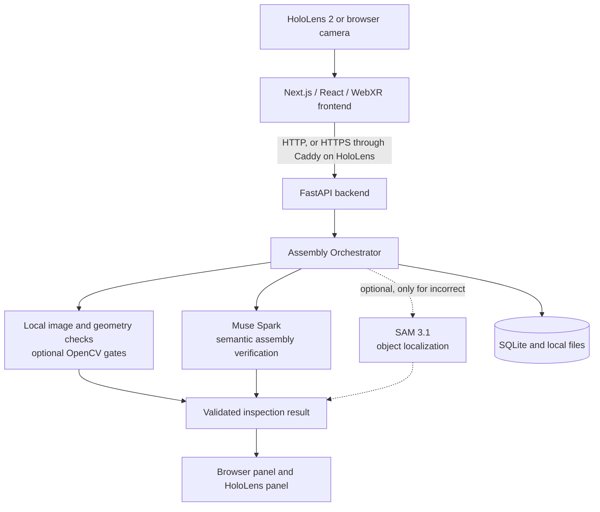

# AssemblyPilot

**Mixed-reality assembly guidance that checks the real build.**

[](https://github.com/JJukic/AssemblyPilot_Meta_Hackathon/actions/workflows/ci.yml)


[](LICENSE)


AssemblyPilot guides a person through a physical assembly step by step and checks each step from
a camera image with Meta-hosted models. It runs in a desktop browser and as a WebXR hologram on
HoloLens 2. Built for the Meta Global AI Developer Hackathon.

| | | | |
| --- | --- | --- | --- |
| 🎥 [Demo video](#demo) | 🚀 [Quickstart](#quickstart) | 🧠 [Meta models](#meta-models) | 🏗️ [Architecture](#architecture) |
| ✨ [Features](#feature-scope) | ⚠️ [Limitations](#known-limitations) | 📄 [Technical Report](docs/technical-report.md) | 📚 [Documentation](#documentation) |

<a id="problem-audience-and-value"></a>

## 🎯 Problem

Assembly mistakes such as a wrong colour, a misplaced part or a printed face turned the wrong way
are easy to miss and expensive to find later. A written manual cannot see what is on the table.
The audience is anyone who assembles physical parts from instructions: learners, hobby builders
and teams at a work bench. The current build is demonstrated with toy bricks only.

<a id="solution"></a>

## ✨ Solution and unique value

You register the blocks, ordered steps and reference photos. AssemblyPilot then runs a closed loop
for each step: show the target, capture the real build, judge it and guide the correction.

- **Evidence over clicks:** a step counts only after a separate fresh image is confirmed by the
  backend. Selecting a button never proves a repair.
- **Honest uncertainty:** when the evidence is unclear, the app says so, asks for a better view
  and waits. It does not guess or spend further requests on its own.
- **Results bound to evidence:** each result stays tied to the exact step and image it came from,
  so a stale status cannot appear as fact in the headset.
- **One workflow, two front ends:** the browser workspace and the HoloLens 2 hologram share one
  backend.

<a id="meta-models"></a>

## 🧠 Meta models

| Component | Role |
| --- | --- |
| **Muse Spark** (`muse-spark-1.3`) | Judges each step as `correct`, `incorrect` or `uncertain`, with issues, evidence and a suggested fix, as strict validated JSON. It can also draft a plan in the setup wizard, which a person must review |
| **SAM 3.1** (`sam-3.1`) | Optional localization. It runs after Muse, only for `incorrect` results, and returns masks, boxes and outlines. It never decides correctness, and the app works without it |
| **OpenCV** (local, not Meta inference) | Optional checks for geometry and printed faces. They can only make a result stricter |

The backend makes the final workflow decision from the Muse result and any configured local
checks. `MODEL_API_KEY` is used **only in the backend** and never reaches the browser. The system
is an orchestrated AI workflow, not a set of autonomous agents. See
[Role of Muse Spark](docs/technical-report.md#role-of-muse-spark) and
[Role of SAM 3.1](docs/technical-report.md#role-of-sam-31).

<a id="demo"></a>

## 🎥 Demo

**[Watch the demo video](https://youtu.be/QWZPpFY55rc)** (166.9 seconds).

The video uses real captures of the browser and HoloLens 2 workflows. Diagrams, including the
`uncertain` state, and the future vision are marked as such. The app has no public deployment.

<a id="quickstart"></a>

## 🚀 Quickstart

The app runs **locally**. You need Git, Python 3.12, Node.js 24 (`package.json` allows 22 or
newer) and [uv](https://docs.astral.sh/uv/getting-started/installation/).

```sh
git clone https://github.com/JJukic/AssemblyPilot_Meta_Hackathon.git
cd AssemblyPilot_Meta_Hackathon
make install
cp -n backend/.env.example backend/.env
cp -n frontend/.env.example frontend/.env.local
```

Set `MODEL_API_KEY` in `backend/.env` for real inference; requests may be billed to you. Then run
each server in its own terminal and open <http://localhost:3000>:

```sh
make dev-backend    # terminal 1, http://localhost:8000
make dev-frontend   # terminal 2, http://localhost:3000
```

The API starts without a key, but no inspection runs. All automated tests run offline:

```sh
make lint && make test
```

| Next | Guide |
| --- | --- |
| First checked step, with all app actions | [Jury quickstart](docs/jury-quickstart.md) |
| pip install, settings, troubleshooting | [Local deployment](docs/local-deployment.md) |
| HoloLens 2 over trusted HTTPS with Caddy | [HoloLens 2 over HTTPS](docs/local-deployment.md#hololens-2-over-https), [HoloLens guide](docs/hololens.md) |

<a id="architecture"></a>

## 🏗️ Architecture



The [Technical Report](docs/technical-report.md#system-architecture) has the full system diagram,
data flow, API, state machine and security model.


<a id="feature-scope"></a>

## ✨ Features

| Feature | Status |
| --- | --- |
| Block library, projects, ordered steps, reference photos, setup wizard | Implemented |
| Browser camera capture (`localhost` or HTTPS) | Implemented |
| Muse Spark inspection and fresh-image verification | Implemented; real requests need a key |
| Correction plan and Active Vision guidance | Implemented |
| Spatial AR with WebXR, guided panel and hologram, with a labelled 2D fallback | Implemented |
| Check Step, Check Again, Confirm Position, Next Step, Finish, Restart Assembly | Implemented |
| Completion hologram after Finish | Implemented; immersive XR only |
| SAM 3.1 localization and object search | Optional; on by default |
| ChArUco calibration, stud geometry, printed-face and print rules | Optional, per step |
| Contour overlays, Canny edge debug | Optional; no effect on verdicts |
| Autonomous Assembly | Optional; explicit start and budgeted Meta requests |
| External camera companion for HoloLens | Optional |
| Local voice commands | Optional; local Whisper, audio never goes to Meta |
| Real-photo accuracy benchmark, completed HoloLens acceptance | Future work; tooling and checklists exist |
| Cloud deployment, authentication, inspection rate limits | Not implemented; trusted local network only |
| Non-Meta inference, autonomous physical correction, native HoloLens app | Not implemented |

The workflow is covered by automated tests that use mocks for Meta and XR and a synthetic camera.
CI runs offline and **does not test live Meta inference or a HoloLens**. What was and was not
verified is in [Verification status](docs/technical-report.md#verification-status).

<a id="known-limitations"></a>

## ⚠️ Limitations

- **Visual judgement:** a single view cannot prove hidden connections, exact measurements or
  stability. Confidence is an uncalibrated model estimate or null.
- **Reference photos:** without an assembled-step photo, spatial results stay conservative.
- **SAM:** no mask does not mean the build is correct.
- **Key:** one key serves Muse and SAM, so without it no inspection runs.
- **HoloLens:** behaviour depends on the Edge build. Anchors last one session. Simultaneous camera
  and WebXR use is not guaranteed, which is why the camera companion exists.
- **Verification:** Finish checks only the last step on the server. Confirm Position cannot
  complete an assembly.
- **Runtime:** sessions and the camera bridge end on a backend restart; progress in SQLite remains.
  There are no migrations or multi-user conflict handling.

<a id="security-notes"></a>

**Security:** the app has no authentication, so run it only on a trusted machine or private
network. Never expose port 8000, and do not use port forwarding, a public tunnel or public DNS.
Never commit keys, certificates, databases or personal recordings. Images go to the Meta API only
on an explicit check or after you start Autonomous Assembly. See the
[security model](docs/technical-report.md#security-and-network-model).

<a id="documentation"></a>

## 📚 Documentation

| Document | Use it for |
| --- | --- |
| [Technical Report](docs/technical-report.md) | Architecture, Meta integration, behaviour, security, tests and verification status |
| [Jury quickstart](docs/jury-quickstart.md) | From a fresh clone to a real checked step |
| [Local deployment](docs/local-deployment.md) | Install options, settings, HoloLens HTTPS, troubleshooting |
| [HoloLens guide](docs/hololens.md) | Spatial guidance, device details and acceptance checklists |
| [Assets and licenses](docs/assets-and-licenses.md) | Asset origins, dependencies, trademarks and open rights questions |

Module references: [setup wizard](docs/jury-setup.md), [inspection API](docs/inspection-api.md),
[registry API](docs/registry-api.md), [verification](docs/verification.md),
[segmentation](docs/segmentation.md), [print recognition](docs/print-recognition.md),
[calibration](docs/calibration.md), [geometry](docs/geometric-verification.md),
[faces](docs/face-verification.md), [contours](docs/contour-overlays.md),
[edge debug](docs/edge-debug.md), [benchmark](docs/benchmark.md),
[completion hologram](docs/completion-mascot.md), [demo video project](demo/remotion/README.md).

<a id="license"></a>

## ⚖️ License and assets

The **source code** is under the Apache License 2.0: see [LICENSE](LICENSE). This does not
automatically cover the bundled assets. The origin of some images and models is not fully
documented, and third-party components keep their own licenses. See
[Assets and licenses](docs/assets-and-licenses.md).

AssemblyPilot is an independent hackathon project. It is not affiliated with, sponsored by or
endorsed by Meta, Microsoft or the LEGO Group. Meta models are named because the project calls
them through the Meta Model API. The mascot is not an official Meta asset.
