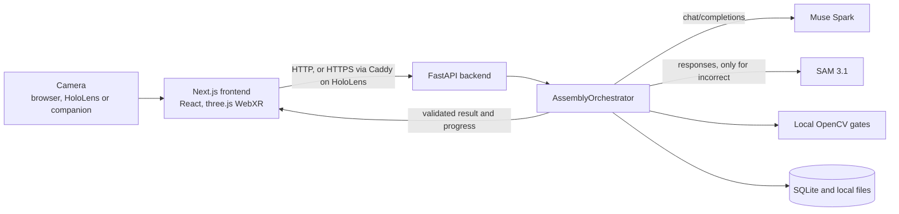

# AssemblyPilot

**Visual Assembly Intelligence.** AssemblyPilot guides a person through a physical
LEGO-style assembly step by step and checks each step from a camera image with Meta-hosted
models. It runs in a desktop or mobile browser and as a WebXR experience on HoloLens 2.

Built for the Meta Global AI Developer Hackathon.

> **Demo video — coming soon.** No demo video exists yet; see
> [Demo video — coming soon](#demo-video--coming-soon).

## Problem, audience and value

- **Problem:** assembly mistakes such as a wrong colour, a misplaced part or a printed face
  turned the wrong way are easy to miss and expensive to find later. A written manual
  cannot see what is on the table.
- **Audience:** people who assemble physical parts from instructions: learners, hobby
  builders, and teams that want an assisted check at a work bench. The current build is
  demonstrated with toy bricks only.
- **Value:** a closed loop. Show the intended step, look at the real build, explain what is
  wrong, and accept a step only after a separate fresh image confirms it. When the model
  cannot tell, the app says so and waits for the user.

## What Meta's models contribute

All inference goes to the Meta Model API. There is no fallback provider and there are no
local model weights for inspection.

| Component | Role |
| --- | --- |
| **Muse Spark** (`muse-spark-1.3`) | Semantic judgement of a step: `correct`, `incorrect` or `uncertain`, with issues and evidence as strict JSON. Also the optional assembly plan in the setup wizard |
| **SAM 3.1** (`sam-3.1`) | Optional segmentation and localization: masks, boxes and outlines. It never overrides Muse |
| OpenCV (local, not Meta) | Optional measured gates for geometry and printed faces. They can only make a result stricter |

The final workflow decision is made by the backend from the Muse result and any configured
local gates. See the [Technical Report](docs/technical-report.md) for the exact rules.

## Architecture overview



Full component and sequence diagrams, endpoints, storage and state transitions are in the
[Technical Report](docs/technical-report.md). New here? Start with the
[Jury quickstart](docs/jury-quickstart.md).

## Feature scope

Status terms used here and in the Technical Report:

| Term | Meaning |
| --- | --- |
| **Implemented** | In this repository, on by default or available without extra setup |
| **Optional** | Implemented and configurable; the app works without it |
| **Not implemented** | Deliberately absent from the code |
| **Planned** | Not done yet, intended later |

| Area | Status | Notes |
| --- | --- | --- |
| Block library, projects, ordered steps, reference photos | Implemented | SQLite and local files; no API key needed |
| Setup wizard (`/setup`) | Implemented | Meta plan generation is an explicit, optional click; manual setup needs no key |
| Browser camera capture | Implemented | `getUserMedia`; localhost or HTTPS only |
| Muse Spark inspection and fresh-image verification | Implemented | Requires `MODEL_API_KEY` |
| Correction plan and Active Vision guidance | Implemented | Built deterministically from the validated diagnosis |
| Spatial AR (`/ar?project=<id>`) with WebXR, guided panel and hologram | Implemented | Falls back to a labelled 2D preview on unsupported devices |
| Guided buttons: Check Step, Check Again, Confirm Position, Next Step, Finish, Restart Assembly | Implemented | See [Assembly workflow](#assembly-workflow) |
| Completion hologram (mascot) after Finish | Implemented | Immersive XR only; loaded only by Finish; failures never affect the workflow |
| SAM 3.1 localization | Optional | `SAM_ENABLED`, on by default; only runs for `incorrect` diagnoses |
| Explicit object search with SAM (`POST /api/vision/objects`) | Optional | User-triggered, independent of the verdict |
| ChArUco calibration, stud geometry, printed-face and print rules | Optional | Only active for steps that configure them |
| Contour overlays, Canny edge debug | Optional | Visual aids; no verdict impact |
| Autonomous Assembly | Optional | Explicit Start; local change detection, budgeted Meta requests |
| External camera companion (`/api/ar-camera`) | Optional | Second browser supplies the frame for HoloLens |
| Local voice commands (Whisper on the Mac) | Optional | Needs a local Whisper engine; audio never goes to Meta |
| Authentication, public deployment, rate limits on inspection | Not implemented | Trusted local network only |
| Local GPU models, non-Meta inference providers | Not implemented | |
| Autonomous physical correction, 3D metrology, native HoloLens app | Not implemented | A Unity/OpenXR path is only described in [docs/hololens.md](docs/hololens.md) |
| Final HoloLens demo recording, local browser demo recording | Planned | See [Demo video — coming soon](#demo-video--coming-soon) |
| Real-photo accuracy benchmark, completed HoloLens acceptance checklists | Planned | Tooling exists; results do not |

## Repository layout

```text
backend/    FastAPI app (app/main.py), SQLModel/SQLite, Pillow, OpenCV, httpx, Meta clients, tests
frontend/   Next.js App Router, React, TypeScript, Tailwind, three.js/WebXR, unit + Playwright tests
data/       Shared practice assembly (data/assemblies/demo-lego.json)
deploy/     Caddyfile.hololens: private-LAN HTTPS proxy template
docs/       Technical report, API contracts, HoloLens guide, validation records
.github/    CI workflow
Makefile    install, dev-backend, dev-frontend, test, lint, build, test-browser, requirements, check-requirements
```

Entry points: `backend/app/main.py` (`app.main:app`) and
`frontend/src/app/(workspace)/page.tsx` (route `/`). Other routes: `/setup`, `/blocks`,
`/projects`, `/projects/[projectId]`, `/ar`, `/settings`.

## Prerequisites

| Tool | Version | Needed for |
| --- | --- | --- |
| Git | any current | Clone |
| Python | 3.12 (`backend/.python-version`; `requires-python >=3.12`) | Backend |
| Node.js | 24 (`.node-version`, used by CI); `package.json` allows `>=22` | Frontend |
| npm | bundled with Node.js | `npm ci` |
| [uv](https://docs.astral.sh/uv/getting-started/installation/) | CI pins 0.12.23; also checked with 0.13.5 | Recommended install; required for `make` and Playwright |
| Chrome, Edge, Firefox or Safari | current | UI; automated tests use Chromium only |
| Webcam | | Real camera use |
| [Caddy](https://caddyserver.com/docs/install) | checked with 2.11.7 | HoloLens only |
| Whisper CLI (`whisper-cli` or `whisper`) | | Optional local voice only |

`requirements.txt` covers Python packages only. Node.js, browsers, Caddy, certificates and
Whisper are installed separately.

Live inference additionally needs your own Meta Model API key with access to the models
(see [Without and with an API key](#without-and-with-an-api-key)). A key is created in the
[Meta Model API dashboard](https://dev.meta.ai/).

## From clone to running application

```sh
git clone https://github.com/JJukic/AssemblyPilot_Meta_Hackathon.git
cd AssemblyPilot_Meta_Hackathon
cp -n backend/.env.example backend/.env
cp -n frontend/.env.example frontend/.env.local
```

### Backend, option A: uv with the unchanged lock file (recommended)

```sh
cd backend
uv sync --frozen
uv run --frozen uvicorn app.main:app --reload --host 127.0.0.1 --port 8000
```

`make install` runs `uv sync --frozen` and `npm ci`; `make dev-backend` starts the same
server from the repository root.

### Backend, option B: venv and pip

Run this from the repository root:

```sh
python3.12 -m venv backend/.venv
backend/.venv/bin/python -m pip install -r backend/requirements.txt
cd backend
.venv/bin/python -m uvicorn app.main:app --host 127.0.0.1 --port 8000
```

The server must start in `backend/` so that `app.main` can be imported. To also run the
Python tests on this path, install both files in one command, because the files contain
hashes: `.venv/bin/python -m pip install -r requirements.txt -r requirements-dev.txt`, then
`.venv/bin/python -m pytest` in `backend/`.

### Frontend

In a second terminal, from the repository root:

```sh
cd frontend
npm ci
npm run dev
```

Open <http://localhost:3000>. `make dev-frontend` is the same as `npm run dev`.

### Health check

```sh
curl --fail http://localhost:8000/health
```

The API schema is at <http://localhost:8000/docs>. The first start creates missing tables
in `backend/data/assemblypilot.db` and the upload directory. Existing data is never reset
or seeded. Use a single backend worker: inspection sessions, voice sessions and the camera
bridge live in process memory.

### Production build

```sh
make build
cd frontend && npm run start
```

`npm run dev` and `npm run start` both bind to `0.0.0.0`, so use them only on a trusted
machine or network. `NEXT_PUBLIC_API_URL` is baked in at build time.

### Dependency sources

| Part | Manifest | Lock file | Install |
| --- | --- | --- | --- |
| Backend | `backend/pyproject.toml` | `backend/uv.lock` | `uv sync --frozen` |
| Backend via pip | generated from `uv.lock` | `backend/requirements.txt`, `backend/requirements-dev.txt` | `python -m pip install -r backend/requirements.txt` |
| Frontend | `frontend/package.json` | `frontend/package-lock.json` | `npm ci` |

`pyproject.toml` and `uv.lock` are the primary source. The requirements files are generated
with resolved versions, environment markers and hashes. Do not edit them by hand. After a
dependency change, regenerate them with `make requirements`, which runs in `backend/`:

```sh
uv export --locked --no-dev --no-emit-project --format requirements-txt --output-file requirements.txt
uv export --locked --only-group dev --no-emit-project --format requirements-txt --output-file requirements-dev.txt
```

`make check-requirements` regenerates both files and fails on any difference. CI runs it.

## Ports and URLs

| Service | Port | Bound to | Started by | Open or use |
| --- | --- | --- | --- | --- |
| FastAPI backend | 8000 | `127.0.0.1` | `make dev-backend` | <http://localhost:8000/health>, <http://localhost:8000/docs> |
| Next.js frontend | 3000 | `0.0.0.0` (`npm run dev`, `npm run start`) | `make dev-frontend` | <http://localhost:3000> on the same machine |
| Caddy HTTPS proxy, HoloLens only | 443 | The private LAN IP in `deploy/Caddyfile.hololens` | `caddy run` | `https://<your-private-ip>/` on every device |

Behind Caddy, `/api/*` and `/health` go to `127.0.0.1:8000`, and everything else goes to
`127.0.0.1:3000`. Never open or forward port 8000 to other devices. Caddy can use another
port; see [HoloLens 2 over HTTPS](#hololens-2-over-https).

## Without and with an API key

| Feature | Without `MODEL_API_KEY` | With your own key |
| --- | --- | --- |
| Install, start, health check, all automated tests | Works | Works |
| Block library, projects, manual setup, reference photos | Works | Works |
| Browser camera preview and capture | Works | Works |
| AR page, hologram, field placement | Works | Works |
| ChArUco calibration, Canny edge debug | Works | Works |
| Inspection and verification (`/api/inspect`, `/api/verify`) | 503 `meta_not_configured`, shown as "Check unavailable" | Real Muse Spark result |
| Setup wizard plan generation | Fails clearly, manual setup continues | Real Muse Spark plan |
| SAM object search (`/api/vision/objects`) | 503 `sam_not_configured` | Real SAM 3.1 result |
| Autonomous Assembly | No results | Budgeted Meta requests |

Real inference needs **all** of these: your own valid key in `backend/.env`, access to
`muse-spark-1.3` (and `sam-3.1` for SAM) on that key, and internet access to
`api.meta.ai`. Requests may be billed to your account. The repository ships no key.
Without a key the app never fabricates a verdict. The only mocked results are in the
automated tests, and `backend/browser_test_server.py` must not be used for a demo.

Never put the key in frontend configuration, source code or a command argument.

## Environment variables

`backend/.env` is resolved from `backend/` regardless of the shell directory. Process
environment variables override it, and other file names such as `.env.backend` are not
loaded automatically. Restart the backend after changes. `NEXT_PUBLIC_*` values are public
and baked in at build time.

**Frontend** (`frontend/.env.local`)

| Variable | Default | Purpose |
| --- | --- | --- |
| `NEXT_PUBLIC_API_URL` | `http://localhost:8000` | Backend origin as seen by the browser; empty string means same origin (HoloLens build) |

**Backend: Meta Model API** (`backend/.env`)

| Variable | Default | Purpose |
| --- | --- | --- |
| `MODEL_API_KEY` | unset | The one Meta key, used for both Muse and SAM. There is no separate SAM key |
| `META_API_BASE_URL` | `https://api.meta.ai/v1` | Only this HTTPS host and path are accepted |
| `META_VISION_MODEL` | `muse-spark-1.3` | Muse model ID |
| `META_REQUEST_TIMEOUT` | `60` | Seconds for the whole Muse operation including retries; max 180 |
| `META_MAX_REFERENCE_IMAGES` | `8` | Reference photos per request, plus the current snapshot; 0–20 |
| `META_MAX_REQUEST_BYTES` | `10485760` | Serialized request limit including base64 |
| `INSPECTION_MAX_DIMENSION` | `1280` | Longest image edge sent to Meta; 256–1600 |

**Backend: SAM 3.1** (optional)

| Variable | Default | Purpose |
| --- | --- | --- |
| `SAM_ENABLED` | `true` | `false` keeps Muse-only inspection |
| `META_SAM_MODEL` | `sam-3.1` | Fixed: any other value fails settings validation |
| `SAM_REQUEST_TIMEOUT` | `60` | Seconds per SAM operation including retries and decoding; max 60 |
| `SAM_MAX_CONCEPTS_PER_INSPECTION` | `2` | SAM operations per inspection; 0–2 |

**Backend: application**

| Variable | Default | Purpose |
| --- | --- | --- |
| `FRONTEND_ORIGIN` | `http://localhost:3000` | Exact CORS origin; `*` is rejected |
| `DATABASE_URL` | `sqlite:///./data/assemblypilot.db` | Relative to `backend/` |
| `UPLOAD_DIR` | `./data/uploads` | Reference photos, relative to `backend/` |
| `CALIBRATION_DIR` | `./data/calibrations` | Versioned calibration JSON, relative to `backend/` |
| `MAX_UPLOAD_BYTES` | `8388608` | Upload limit |
| `MAX_IMAGE_PIXELS` | `20000000` | Decoded pixel limit |
| `MAX_IMAGE_DIMENSION` | `8192` | Maximum input edge |
| `MIN_IMAGE_DIMENSION` | `32` | Minimum input edge |
| `RESIZE_MAX_DIMENSION` | `1600` | Longest stored reference edge; never upscales |
| `INSPECTION_SESSION_CAPACITY` | `64` | In-memory inspection sessions; 1–256 |
| `INSPECTION_SESSION_TTL_SECONDS` | `1800` | Session lifetime; 60–7200 |
| `FACE_CANNY_SIGMA` | `0.33` | Adaptive Canny spread for printed faces; 0.1–0.6 |

**Backend: local voice** (optional)

| Variable | Default | Purpose |
| --- | --- | --- |
| `VOICE_WHISPER_COMMAND` | empty | Empty auto-detects `whisper-cli`, `main`, then `whisper` |
| `VOICE_WHISPER_MODEL` | `tiny` | Model name for the `whisper` CLI |
| `VOICE_WHISPER_MODEL_PATH` | empty | Model file for whisper.cpp |
| `VOICE_MAX_AUDIO_BYTES` | `1000000` | Clip size limit |
| `VOICE_MAX_DURATION_SECONDS` | `8` | Clip duration limit |
| `VOICE_SESSION_TTL_SECONDS` | `600` | Voice session lifetime |
| `VOICE_RATE_LIMIT_PER_MINUTE` | `30` | Per-session limit |
| `VOICE_MAX_SESSIONS` | `256` | Concurrent sessions |
| `VOICE_TRANSCRIBE_TIMEOUT_SECONDS` | `60` | Transcription deadline |

## Local browser test without HoloLens

1. Start backend and frontend, with `MODEL_API_KEY` set in `backend/.env`.
2. Create content in one of these ways:
   - Open `/setup` and follow the five-step wizard
     ([guide and acceptance checklist](docs/jury-setup.md)).
   - Or use `/blocks` and `/projects`.
   - Or run the two-step demo project, which prints JSON with the project ID and AR path:
     `cd backend && uv run --frozen python scripts/create_ar_demo.py`
3. Add a photo of the correctly assembled step. Without one, spatial judgments are
   deliberately conservative.
4. **Workspace flow** at `/`: select the project and step, **Start camera**, **Capture**,
   **Inspect with Meta AI**. After `incorrect`, correct the build, choose **I've corrected
   it**, then **Capture & Verify**.
5. **Guided flow** at `/ar?project=<id>`: without an XR session the page shows the same
   guided card and panel actions as HoloLens, using the local browser camera.

The dashboard polls the backend status every 10 seconds; the camera works even when the
backend is down. The five-step practice assembly from `data/assemblies/demo-lego.json` has no registered
SQLite context and therefore offers no AI inspection. Calibration and edge debugging are
under **Settings** (`/settings`).

Captures stay in browser memory until you explicitly inspect them or save them as
reference photos.

## Assembly workflow

A step's verdict starts with Muse Spark. Optional OpenCV and print gates can only make it
stricter, never better. Only the backend can record a step as `verified`.

| Result | What the user sees | Buttons | What happens next |
| --- | --- | --- | --- |
| `correct` (first image) | "Check Step" continues automatically | none while running | About 2 seconds later a **separate, fresh** frame goes to `POST /api/verify` |
| Verified by backend | "Correct" | Next Step, or Finish on the last step | Progress is stored in SQLite |
| `correct`, verification still missing | "Almost correct" | Check Again | Check Again starts a new inspection and verification |
| `incorrect` | "Try again" with the issue and suggested fix | Check Again | Adjust the build; Check Again uses a fresh image |
| `uncertain` | "Position uncertain" with the requested view | Check Again, Confirm Position | **Nothing is sent** until the user selects Check Again |
| Check could not run | "Check unavailable" | Check Again, Confirm Position | An infrastructure failure is never shown as a verdict |

- **Check Again** captures exactly one new frame and starts one new inspection. Old images
  are never reused: the backend rejects a repeated snapshot during verification.
- **Confirm Position** is a local, user-confirmed fallback. It is labelled "not AI
  verified", writes nothing to the backend and cannot enable Finish.
- **Finish** appears only on the last step after backend verification. It re-reads server
  progress, then shows "Assembly complete" and the completion hologram. It starts no
  camera and no Meta request.
- **Restart Assembly** appears after Finish. It creates a new server run
  (`POST /api/projects/{id}/assembly-runs`), which makes all steps unverified and returns
  to Step 1. Nothing is deleted, and no camera or Meta action starts.

## HoloLens 2 over HTTPS

**Check this first:** WebXR and the camera require a secure context, so HoloLens needs
HTTPS. The API has no authentication. Use only a trusted shared network, keep both servers
on loopback and expose only the TLS proxy, restricted by firewall to trusted devices. Do not
use public tunnels or router port forwarding, and do not expose port 8000. The HoloLens
Device Portal is a separate management interface. AssemblyPilot does not need it for
serving the app, and it must never be exposed publicly.

1. Find the serving Mac's private IP, for example `ipconfig getifaddr en0`. The IP changes
   between networks.
2. Copy the template to an ignored or temporary location and replace **both** `192.168.1.50`
   occurrences with that IP:

   ```sh
   sed "s/192\.168\.1\.50/$(ipconfig getifaddr en0)/g" deploy/Caddyfile.hololens > /tmp/Caddyfile.hololens
   ```

3. Build the frontend with an **empty** API base, so requests use the same HTTPS origin, and
   start it on loopback:

   ```sh
   cd frontend
   NEXT_PUBLIC_API_URL='' npm run build
   npx next start --hostname 127.0.0.1 --port 3000
   ```

4. Start the backend in a second terminal, from `backend/`, without `--reload`:

   ```sh
   uv run --frozen uvicorn app.main:app --host 127.0.0.1 --port 8000
   ```

5. Start Caddy in a third terminal:

   ```sh
   sudo caddy run --config /tmp/Caddyfile.hololens --adapter caddyfile
   ```

   On macOS, binding a specific IP to port 443 fails with "permission denied" without
   `sudo`, and Caddy also binds port 80 for its HTTP redirect. To avoid `sudo`, add this
   block at the top of your copy, change the site line to `https://<ip>:3443 {` and open
   `https://<ip>:3443/` instead. Install the root certificate manually as in the next step:

   ```text
   {
       auto_https disable_redirects
       skip_install_trust
   }
   ```

6. Trust Caddy's internal CA on each client. Install **only the public** root certificate:
   `pki/authorities/local/root.crt` in Caddy's data directory. `caddy environ | grep
   AppDataDir` shows that directory; under `sudo`, run it with `sudo` too, since root can
   have a different one. Never distribute the private key. On HoloLens follow
   [Microsoft's certificate manager guide](https://learn.microsoft.com/en-us/hololens/certificate-manager).
   Do not bypass certificate warnings.

### On the headset

1. Open `https://<your-private-ip>/ar?project=<project-id>` in HoloLens Edge.
2. Select **Enter immersive AR**, rotate the assembly field to match the baseplate and
   select **Confirm Assembly Field**.
3. Place the brick and select **Check Step** with a hand ray and Air Tap.
4. The default camera source is the HoloLens camera, probed while XR stays active. If no
   advancing frames arrive, the panel shows a pairing code. Open the same project page on
   a Mac or iPhone, enter the code and select **Act as external camera companion**. That
   device captures and inspects, and only a validated text summary returns to HoloLens.

To film the headset view later, use Mixed Reality Capture ([demo plan](docs/demo-plan.md)).
Use the same HTTPS URL on all devices so they share state. Details, coordinate
conventions, voice setup and manual checklists are in [docs/hololens.md](docs/hololens.md).

## Troubleshooting

| Symptom | Likely cause | What to do |
| --- | --- | --- |
| `address already in use` on 8000, or `next start` fails on 3000 | Another server runs | `lsof -nP -iTCP:8000 -sTCP:LISTEN` (or `:3000`), then stop that process. Do not point a demo at a server you did not start |
| `make test-browser` fails to start | Port 8000 is in use | Playwright refuses to reuse a server. Stop the development backend first |
| Dashboard shows the backend as offline | Backend is down, or the wrong API URL was built in | `curl --fail http://localhost:8000/health`, then check `NEXT_PUBLIC_API_URL` and rebuild. The value is baked in at build time |
| CORS error in the browser console | The page origin differs from `FRONTEND_ORIGIN` | Open the app at exactly `http://localhost:3000`, or set `FRONTEND_ORIGIN` to the real origin and restart the backend. Same-origin HTTPS through Caddy needs no CORS |
| API calls from another device go to `localhost` | The build uses the default API URL | Use the HoloLens build with an empty `NEXT_PUBLIC_API_URL` through Caddy |
| "Check unavailable" on every check | No key, a wrong key, no model access, or no internet | Set `MODEL_API_KEY` in `backend/.env` and restart the backend. `.env.backend` is not loaded |
| LAN IP changed, HoloLens cannot connect | The Mac joined another network | Find the new IP, update both addresses in your Caddy copy, restart Caddy and use the new URL. No frontend rebuild is needed with an empty API base |
| `next dev` blocks requests from another device | `allowedDevOrigins` in `frontend/next.config.ts` lists only specific IPs | Use the production build for LAN tests. This list affects development mode only |
| Certificate warning | The client does not trust Caddy's root | Install `root.crt` on that client. A new Caddy data directory, for example under `sudo`, means a new root |
| Camera does not start in the browser | Not a secure context, or permission denied | Use `localhost` or trusted HTTPS, allow the camera for the site and in the OS privacy settings, and close other apps using the camera. `window.isSecureContext` must be `true` |
| No camera frames on HoloLens during XR | Headset browser limit | Use the pairing code and the external camera companion |
| `Permission denied` when Caddy starts | Ports 443 or 80 on a specific IP on macOS | Use `sudo`, or the `:3443` variant above, which also turns off the port 80 redirect |

## Tests

```sh
make lint          # Ruff + ESLint (warnings fail)
make test          # pytest, strict TypeScript check, frontend unit tests
make build         # Next.js production build
make check-requirements   # requirements files still match uv.lock
cd frontend && npx playwright install chromium   # first run only
cd .. && make test-browser                       # Next.js build + Playwright
```

There is no Markdown lint in this repository. The latest recorded results are in
[Submission readiness](docs/submission-readiness.md).

- CI (`.github/workflows/ci.yml`) runs on every push and pull request with no Meta
  credentials: the requirements check, Ruff and pytest in the backend job; ESLint, type check, unit tests, build
  and Playwright in the frontend job.
- Playwright starts a disposable API with a temporary database, and refuses to reuse a
  server on port 8000. Stop your development backend first. `make test-browser` overwrites
  `frontend/.next`, so rebuild afterwards if you need the HoloLens build.
- Browser tests use a **synthetic** Chromium camera and mocked Meta results. Tests mock XR
  poses and GPU rendering. They do not prove physical camera, HoloLens or recognition
  quality.

Live checks are opt-in, potentially billable and never run in CI. Without credentials or
opt-in they exit 77:

```sh
cd backend
uv run --frozen python smoke_inspection.py --project-id ID --step-id ID --image /abs/photo.jpg
uv run --frozen python smoke_segmentation.py --image /abs/photo.jpg --output data/sam-smoke/annotated.png
uv run --frozen python smoke_verification.py --run-live --project-id ID --step-id ID --before /abs/a.jpg --after /abs/b.jpg
```

For a labelled real-image evaluation, see [docs/benchmark.md](docs/benchmark.md).

## Current development status

- Automated results and manual records are kept in
  [docs/validation.md](docs/validation.md) and the
  [Technical Report](docs/technical-report.md#test-strategy).
- `docs/hololens.md` records observations **reported by the project owner** on a real
  HoloLens 2: immersive WebXR
  works, the microphone is reachable, browser speech recognition is not usable, and a
  live camera image works in the 2D workspace. The manual acceptance checklists there,
  including simultaneous camera and WebXR use, are still open.
- The repository contains no recorded real-photo benchmark. The owner reports working
  live Muse inference locally; this is an owner report, not a repository record. The live SAM path and the correction loop have no recorded
  real-image result in the repository.

## Demo video — coming soon

> No demo video exists yet. This section contains no links or results on purpose. The
> planned recordings are listed in the [demo plan](docs/demo-plan.md).

## Known limitations

- **Security:** no authentication and no inspection rate limits. Use only on a trusted
  machine or private network.
- **Visual judgment is fallible:** a single view cannot prove hidden connections, exact
  measurements or stability. Confidence is an uncalibrated model estimate or null.
- **Assembled-step photo:** without one, spatial results stay conservative.
- **SAM coverage:** the automatic pass runs only for `incorrect` diagnoses, for at most two
  operations. No mask does not mean the build is correct.
- **`MODEL_API_KEY`:** one key serves Muse and SAM, so without it no inspection runs at all.
- **HoloLens:** behavior depends on the installed Edge build. Anchors last for one session,
  so the field must be confirmed again after re-entering AR. Simultaneous camera and WebXR
  use is a device result, not a guarantee, and the companion path exists for this reason.
- **Navigation is not verification:** moving between steps verifies nothing, and Finish
  checks only the last step on the server. It reports how many steps were verified.
- **Confirm Position on the last step** cannot complete the assembly; Finish requires
  backend verification.
- **Single process:** sessions and the camera bridge expire on backend restart. Progress in
  SQLite remains.
- **Persistence:** SQLModel `create_all` only, with no migration framework. Back up the
  database and upload directory together with the backend stopped.
- **Registry:** no pagination, cloud sync or multi-user conflict handling; edits are
  last-write-wins.

## Data and privacy

**Images sent to Meta:** the current snapshot, reference photos for the step (block and
assembled-step references, at most `META_MAX_REFERENCE_IMAGES`, resized to at most
`INSPECTION_MAX_DIMENSION`), an optional print crop of the snapshot, the same snapshot to
SAM, and photos used for plan generation in the setup wizard. Details are in the
[Technical Report](docs/technical-report.md#images-sent-to-the-meta-api). Do not show
people, faces or private documents to the camera. Voice audio stays on the serving machine.

Keep personal photos, `.env` files and API keys out of Git; default data paths are ignored.
Images are sent to Meta only on an explicit inspection, or by Autonomous Assembly after you
start it. API responses expose `/api/media/{id}` URLs, never file paths. Deleting a project
keeps reusable blocks and their photos; deleting a block that a step uses returns 409.

## Documentation

| Document | Content |
| --- | --- |
| [Jury quickstart](docs/jury-quickstart.md) | Fresh clone to your first checked step |
| [Technical Report](docs/technical-report.md) | Architecture, data flow, decisions, security, testing, limits |
| [Submission checklist](docs/submission-checklist.md), [Submission readiness](docs/submission-readiness.md) | Organizer requirements, evidence, executed checks, open blockers |
| [Demo plan](docs/demo-plan.md) | Planned recordings |
| [Assets and licenses](docs/assets-and-licenses.md) | Dependency licenses and open asset questions |
| [HoloLens guide](docs/hololens.md) | XR setup, coordinates, voice, autonomy, device checklists |
| [Jury setup](docs/jury-setup.md) | Setup wizard and acceptance checklist |
| [Inspection API](docs/inspection-api.md), [Registry API](docs/registry-api.md) | Schemas, errors, limits |
| [Verification](docs/verification.md) | Workflow states and correction loop |
| [Segmentation](docs/segmentation.md) | SAM protocol, routing and limits |
| [Calibration](docs/calibration.md), [Geometry](docs/geometric-verification.md) | ChArUco, stud offsets |
| [Faces](docs/face-verification.md), [Print recognition](docs/print-recognition.md) | Printed-face and text rules |
| [Contours](docs/contour-overlays.md), [Edge debug](docs/edge-debug.md) | Visual diagnostics |
| [Completion hologram](docs/completion-mascot.md) | Mascot behavior and checks |
| [Architecture notes](docs/architecture.md), [Benchmark](docs/benchmark.md) | Module-level detail, evaluation runner |
| [Validation log](docs/validation.md) | Dated records of executed checks |

## License

Source code: Apache License 2.0; see [LICENSE](LICENSE). The origin of some bundled images
and models is not fully documented, and third-party components keep their own licenses;
see [Assets and licenses](docs/assets-and-licenses.md).
