# AssemblyPilot

**Mixed-reality assembly guidance that checks the real build.**

[](https://github.com/JJukic/AssemblyPilot_Meta_Hackathon/actions/workflows/ci.yml)


[](LICENSE)


AssemblyPilot guides a person through a physical assembly step by step and checks each step
from a camera image with Meta-hosted models. When a step is wrong it explains the fix, and when
the evidence is unclear it says so and waits. It runs in a desktop browser and as a WebXR
hologram on HoloLens 2. Built for the Meta Global AI Developer Hackathon.

| | | | |
| --- | --- | --- | --- |
| 🎥 [Demo](#demo) | 🚀 [Installation](#installation) | 🥽 [HoloLens 2](#hololens-2) | 🧠 [Meta models](#meta-models) |
| 🏗️ [Architecture](#architecture) | 🧪 [Tests](#tests) | 📄 [Technical Report](docs/technical-report.md) | ⚖️ [Licenses and assets](docs/assets-and-licenses.md) |

<a id="problem-audience-and-value"></a>

## 🎯 Problem

Assembly mistakes such as a wrong colour, a misplaced part or a printed face turned the wrong
way are easy to miss and expensive to find later. A written manual cannot see what is on the
table. The audience is anyone who assembles physical parts from instructions: learners, hobby
builders and teams at a work bench. The current build is demonstrated with toy bricks only.

<a id="solution"></a>

## ✨ Solution

You register the blocks, ordered steps and reference photos. AssemblyPilot then runs a closed
loop for each step: show the target, capture the real build, judge it and guide the correction.
A step counts only after a separate fresh image is confirmed by the backend.

<a id="feature-scope"></a>

## ✨ Features

| Mark | Meaning |
| --- | --- |
| ✅ | Implemented |
| 🧪 | Covered by automated tests, with mocks for Meta and XR |
| ⚠️ | Optional: implemented and configurable, and the app works without it |
| 🔭 | Future work |
| ❌ | Not implemented |

| Feature | Status | Notes |
| --- | --- | --- |
| Block library, projects, ordered steps, reference photos | ✅ 🧪 | SQLite and local files; no key needed |
| Setup wizard (`/setup`) | ✅ 🧪 | Manual setup needs no key |
| Browser camera capture | ✅ 🧪 | `localhost` or HTTPS only; tests use a synthetic camera |
| Muse Spark inspection and fresh-image verification | ✅ 🧪 | Real requests need `MODEL_API_KEY` |
| Correction plan and Active Vision guidance | ✅ 🧪 | Built from the validated result |
| Spatial AR with WebXR, guided panel and hologram | ✅ 🧪 | Falls back to a labelled 2D preview |
| Check Step, Check Again, Confirm Position, Next Step, Finish, Restart Assembly | ✅ 🧪 | See [behaviour by result](docs/technical-report.md#behaviour-by-result) |
| Completion hologram after Finish | ✅ 🧪 | Immersive XR only; never affects the workflow |
| SAM 3.1 localization | ⚠️ 🧪 | `SAM_ENABLED`, on by default; runs only for `incorrect` results |
| Object search with SAM (`POST /api/vision/objects`) | ⚠️ 🧪 | User-triggered, independent of the verdict |
| ChArUco calibration, stud geometry, printed-face and print rules | ⚠️ 🧪 | Active only for steps that configure them |
| Contour overlays, Canny edge debug | ⚠️ 🧪 | Visual aids with no verdict impact |
| Autonomous Assembly | ⚠️ 🧪 | Explicit start; budgeted Meta requests |
| External camera companion (`/api/ar-camera`) | ⚠️ 🧪 | A second browser supplies the frame for HoloLens |
| Local voice commands | ⚠️ 🧪 | Local Whisper; audio never goes to Meta |
| Real-photo accuracy benchmark | 🔭 | Tooling exists; results do not |
| Completed HoloLens acceptance checklists | 🔭 | See the [HoloLens guide](docs/hololens.md) |
| Cloud deployment | ❌ | Started locally on purpose. [What it would need](docs/local-deployment.md#later-cloud-deployment) |
| Authentication, rate limits on inspection | ❌ | Trusted local network only |
| Local GPU models, non-Meta inference providers | ❌ | All inference goes to the Meta Model API |
| Autonomous physical correction, 3D metrology, native HoloLens app | ❌ | A Unity/OpenXR path is only described |

<a id="meta-models"></a>

## 🧠 Meta models

| Component | Role |
| --- | --- |
| **Muse Spark** (`muse-spark-1.3`) | Semantic judgement of a step: `correct`, `incorrect` or `uncertain`, with issues and evidence as strict JSON |
| **SAM 3.1** (`sam-3.1`) | Optional localization and segmentation: masks, boxes and outlines. It does not decide correctness on its own |
| **OpenCV** (local, not Meta inference) | Optional checks for geometry and printed faces. They can only make a result stricter |

The backend makes the final workflow decision from the Muse result and any configured local
checks. `MODEL_API_KEY` is used **only in the backend** and never reaches the browser. The
system is an orchestrated AI workflow, not a set of autonomous agents.

<a id="architecture"></a>

## 🏗️ Architecture

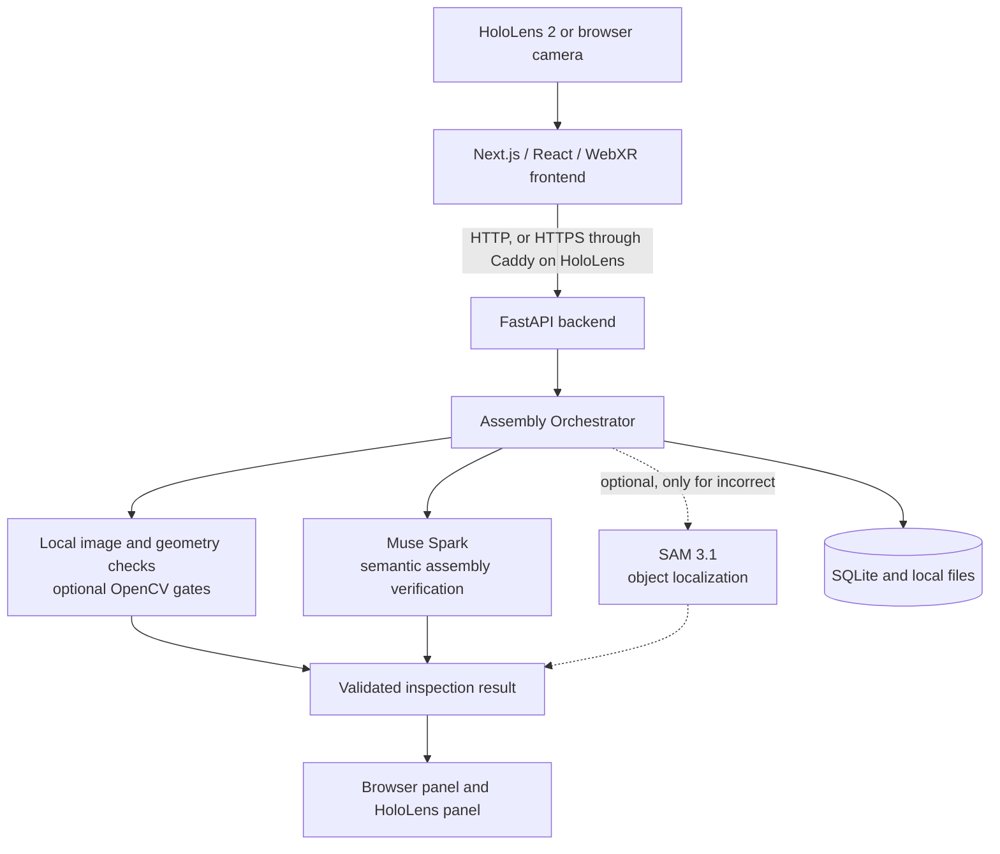

Details are in the [Technical Report](docs/technical-report.md) and the
[architecture notes](docs/architecture.md).

<a id="built-with"></a>

### Built with

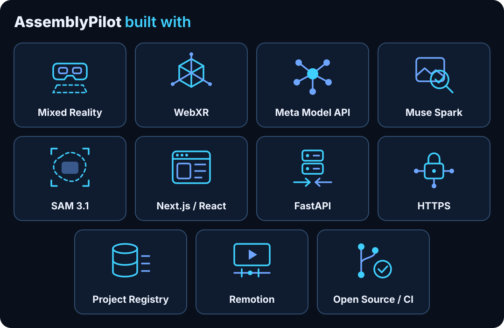

<details>
<summary>Text list of the tiles</summary>

| Tile | Part | Used for |
| --- | --- | --- |
| 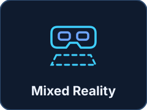 | Mixed Reality | HoloLens 2 headset view through WebXR |
| 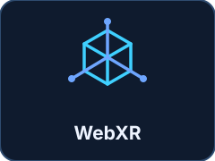 | WebXR | WebXR session and three.js hologram |
| 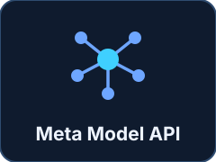 | Meta Model API | Hosted inference, called only by the backend |
| 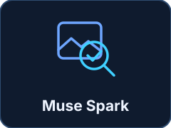 | Muse Spark | Evaluates the assembly state |
| 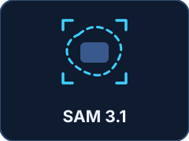 | SAM 3.1 | Optional object localization and segmentation |
| 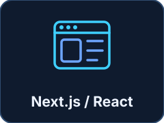 | Next.js / React | Web workspace, setup wizard and AR page |
| 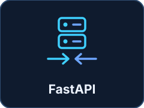 | FastAPI | Python API and Assembly Orchestrator |
| 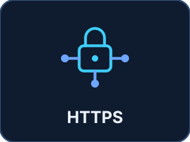 | HTTPS | Caddy with an internal CA on the private network |
| 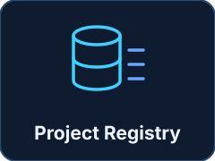 | Project Registry | SQLite and local reference photos |
| 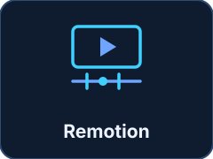 | Remotion | Separate demo video project |
| 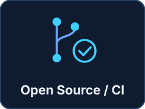 | Open Source / CI | Apache-2.0 source and GitHub Actions checks |

</details>

The pictograms are generic drawings made for this repository, not product logos.

<a id="demo"></a>

## 🎥 Demo

**[Watch the demo video](https://youtu.be/QWZPpFY55rc)** (final render: 166.9 seconds, as
recorded in [`CLIP_MAPPING.md`](demo/remotion/CLIP_MAPPING.md)).

| Part of the video | What it shows |
| --- | --- |
| 🥽 HoloLens 2 | Real captures of the field, hologram, guided panel and correction loop |
| 🚀 Local browser demo | A real capture of the same workflow in a browser |
| Diagrams | Marked as diagrams, including the `uncertain` state, which is not in the recordings |
| 🔭 Future vision | Marked as not implemented |

The video is a recording. The app has no public deployment. The video project is separate from
the application: see [`demo/remotion/`](demo/remotion/README.md).

<a id="installation"></a>

## 🚀 Installation

The app runs **locally**. There is no cloud deployment.

You need Git, Python 3.12, Node.js 24 (`package.json` allows 22 or newer) and
[uv](https://docs.astral.sh/uv/getting-started/installation/).

```sh
git clone https://github.com/JJukic/AssemblyPilot_Meta_Hackathon.git
cd AssemblyPilot_Meta_Hackathon
make install
cp -n backend/.env.example backend/.env
cp -n frontend/.env.example frontend/.env.local
```

Set `MODEL_API_KEY` in `backend/.env` for real inference. Keep existing local configuration
when restarting an installed copy. Then run each server in its own terminal:

```sh
make dev-backend    # terminal 1
make dev-frontend   # terminal 2
```

Open <http://localhost:3000>. The API starts without a key, and all automated tests run offline.
Real Muse or SAM requests need your own valid Meta key in `backend/.env`.

| Service | Port | Reach it at |
| --- | --- | --- |
| Frontend (Next.js) | 3000 | <http://localhost:3000> |
| Backend (FastAPI) | 8000, on loopback only | <http://localhost:8000/health>, <http://localhost:8000/docs> |
| Caddy HTTPS proxy, HoloLens only | 443 | `https://<your-private-ip>/` |

Behind Caddy, `/api/*` and `/health` go to port 8000, and everything else goes to port 3000.

| Next | Guide |
| --- | --- |
| First checked step, with all app actions | [Jury quickstart](docs/jury-quickstart.md) |
| Install with pip instead of uv | [Install with pip](docs/local-deployment.md#install-with-pip) |
| All settings | [Environment variables](docs/local-deployment.md#environment-variables) |
| What works without a key | [Without and with an API key](docs/local-deployment.md#without-and-with-an-api-key) |
| Something does not work | [Troubleshooting](docs/local-deployment.md#troubleshooting) |

<a id="hololens-2"></a>

## 🥽 HoloLens 2

WebXR and the camera need trusted HTTPS, so HoloLens connects through Caddy on a shared private
network. The HoloLens Device Portal is separate from the application.
[HoloLens 2 over HTTPS](docs/local-deployment.md#hololens-2-over-https) has the steps, and the
[HoloLens guide](docs/hololens.md) has the details.

<a id="tests"></a>

## 🧪 Tests

```sh
make test                 # pytest, type check, frontend unit tests
make lint                 # Ruff and ESLint
make build                # Next.js production build
make check-requirements   # requirements files match uv.lock
make check-repo           # no local data or key-like values are tracked
make test-browser         # Playwright; first run: cd frontend && npx playwright install chromium
```

CI runs these on every push and pull request, offline and with no Meta credentials. It uses mocks
and a synthetic camera, so **it does not test live Meta inference or a HoloLens**. Results are in
[Submission readiness](docs/submission-readiness.md).

<a id="known-limitations"></a>

## ⚠️ Limitations

- **Security:** no authentication and no inspection rate limits.
- **Visual judgement:** a single view cannot prove hidden connections, exact measurements or
  stability. Confidence is an uncalibrated model estimate or null.
- **Reference photos:** without an assembled-step photo, spatial results stay conservative.
- **SAM:** it runs only for `incorrect` results, for at most two operations. No mask does not
  mean the build is correct.
- **Key:** one key serves Muse and SAM, so without it no inspection runs.
- **HoloLens:** behaviour depends on the Edge build. Anchors last one session. Simultaneous camera
  and WebXR use is not guaranteed, which is why the camera companion exists.
- **Verification:** moving between steps verifies nothing, and Finish checks only the last step on
  the server. Confirm Position cannot complete an assembly.
- **Single process:** sessions and the camera bridge end on a backend restart. Progress in SQLite
  remains.
- **Persistence:** no migrations, pagination, cloud sync or multi-user conflict handling.

<a id="security-notes"></a>

## 🔐 Security

- Do not commit API keys, private certificates, databases, uploads or personal recordings.
  `make check-repo` and CI catch common mistakes.
- Run the app only on a trusted machine or private network. Never open or forward port 8000.
- For HoloLens, do not use router port forwarding, a public tunnel or public DNS. The Device Portal
  must never be public.
- Images go to the Meta API only on an explicit check or after you start Autonomous Assembly. See
  [Data and privacy](docs/local-deployment.md#data-and-privacy).

Details are in the [Technical Report](docs/technical-report.md#security-and-network-model).

<a id="documentation"></a>

## 📚 Documentation

| Topic | Documents |
| --- | --- |
| 🚀 Getting started | [Jury quickstart](docs/jury-quickstart.md), [Local deployment](docs/local-deployment.md), [Jury setup](docs/jury-setup.md) |
| 🏗️ Design | [Technical Report](docs/technical-report.md), [Architecture notes](docs/architecture.md), [Verification](docs/verification.md) |
| 🧠 Models and APIs | [Inspection API](docs/inspection-api.md), [Registry API](docs/registry-api.md), [Segmentation](docs/segmentation.md), [Print recognition](docs/print-recognition.md) |
| 🥽 HoloLens | [HoloLens guide](docs/hololens.md), [Completion hologram](docs/completion-mascot.md) |
| Vision tools | [Calibration](docs/calibration.md), [Geometry](docs/geometric-verification.md), [Faces](docs/face-verification.md), [Contours](docs/contour-overlays.md), [Edge debug](docs/edge-debug.md), [Benchmark](docs/benchmark.md) |
| 🎥 Demo | [Demo record](docs/demo-plan.md), [Remotion project](demo/remotion/README.md) |
| 🧪 Status | [Submission readiness](docs/submission-readiness.md), [Submission checklist](docs/submission-checklist.md) |
| Historical checks | [Validation log](docs/validation.md), [Meta validation 2026-10-27](docs/real-meta-validation-2026-10-27.md), [PR 6 review](docs/pr6-integration-review.md) |

<a id="license"></a>

## ⚖️ License and assets

The **source code** is under the Apache License 2.0: see [LICENSE](LICENSE). This does not
automatically cover the bundled assets. The origin of some images and models is not fully
documented, and third-party components keep their own licenses. See
[Assets and licenses](docs/assets-and-licenses.md).

AssemblyPilot is an independent hackathon project. It is not affiliated with, sponsored by or
endorsed by Meta, Microsoft or the LEGO Group. Meta models are named because the project calls
them through the Meta Model API. The mascot is not an official Meta asset.
