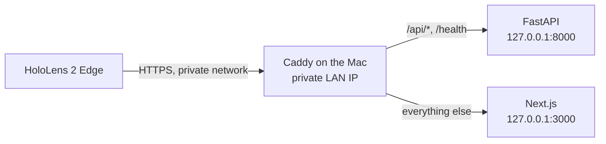

# Local deployment

AssemblyPilot runs locally for the hackathon. **There is no public production deployment.**
This guide covers the two supported local setups and how the app would have to change before
any cloud deployment.

| Setup | For | HTTPS | Needs |
| --- | --- | --- | --- |
| [Local browser](#local-browser) | One machine, jury test | Not needed: `localhost` is a secure context | Python 3.12, Node.js, uv |
| [HoloLens over a private network](#hololens-over-a-private-network) | Real device test | Required, through Caddy | The above, Caddy, a shared private network, a trusted root certificate |

## Local browser

```sh
make install
cp backend/.env.example backend/.env
cp frontend/.env.example frontend/.env.local
make dev-backend    # terminal 1
make dev-frontend   # terminal 2
```

Open <http://localhost:3000>. Set `MODEL_API_KEY` in `backend/.env` for real inference, and
restart the backend after any change. Without a key the app starts, and checks show
"Check unavailable". See the [Jury quickstart](jury-quickstart.md).

| Service | Address | Started by |
| --- | --- | --- |
| Backend | `127.0.0.1:8000` | `make dev-backend` |
| Frontend | `0.0.0.0:3000` | `make dev-frontend` |

The Next.js development server listens on all interfaces, so use it on a trusted network.
The backend listens on loopback only.

### Local data

| Data | Location | In Git |
| --- | --- | --- |
| Database | `backend/data/assemblypilot.db` | No |
| Reference photos | `backend/data/uploads/` | No |
| Calibration JSON | `backend/data/calibrations/` | No |
| Secrets | `backend/.env` | No |

Back up the database and the upload directory together, with the backend stopped. The first
start creates missing tables. Existing data is never reset or seeded.

## HoloLens over a private network

WebXR and the camera need a secure context, so HoloLens must reach the app over trusted
HTTPS. Caddy provides that on the private network, using its internal certificate authority.



Rules:

- Use only a trusted shared network.
- Do not forward router ports, and do not use a public tunnel or public DNS.
- Keep both servers on loopback. Do not expose port 8000.
- Limit the proxy port to trusted devices with the firewall.
- The API has no authentication.

The **HoloLens Device Portal** is a separate management interface. The app does not need it,
and it must never be exposed publicly. It is used only to manage the device, for example for
Mixed Reality Capture.

The exact steps, including building with an empty API URL, starting Caddy, the non-root
`:3443` variant and installing the root certificate, are in
[HoloLens 2 over HTTPS](../README.md#hololens-2-over-https). More detail is in the
[HoloLens guide](hololens.md).

## Later: cloud deployment

This is a **future option**. Nothing here is implemented, and this repository contains no
cloud configuration. A hosted version would need at least:

| Area | Current state | Needed for a hosted version |
| --- | --- | --- |
| Access | No authentication | Authentication and per-user authorization |
| Abuse and cost | No rate limits on inspection | Rate limits and spending limits |
| Sessions | In process memory, single worker | Shared session and camera bridge state |
| Data | SQLite and local files, no migrations | Managed database, object storage, migrations |
| Privacy | Local photos, one local operator | Retention rules, consent and deletion paths |
| Secrets | `backend/.env` | A managed secret store |
| TLS | Caddy with an internal CA | A public certificate |
