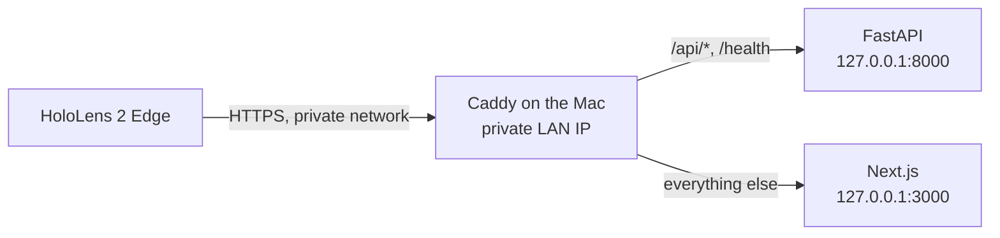

# Local deployment

AssemblyPilot runs locally for the hackathon. **There is no public production deployment.**
This guide covers the two supported local setups and how the app would have to change before
any cloud deployment.

| Setup | For | HTTPS | Needs |
| --- | --- | --- | --- |
| [Local browser](#local-browser) | One machine, jury test | Not needed: `localhost` is a secure context | Python 3.12, Node.js, uv |
| [HoloLens over a private network](#hololens-over-a-private-network) | Real device test | Required, through Caddy | The above, Caddy, a shared private network, a trusted root certificate |

<a id="local-browser"></a>

## 🚀 Local browser

```sh
make install
cp -n backend/.env.example backend/.env
cp -n frontend/.env.example frontend/.env.local
make dev-backend    # terminal 1
make dev-frontend   # terminal 2
```

Open <http://localhost:3000>. Set `MODEL_API_KEY` in `backend/.env` for real inference, and
restart the backend after any change. Without a key the app starts, and checks show
"Check unavailable". See the [Jury quickstart](jury-quickstart.md).

| Service | Address | Started by |
| --- | --- | --- |
| Backend | `127.0.0.1:8000` | `make dev-backend` |
| Frontend | `0.0.0.0:3000` | `make dev-frontend` |

The Next.js development server listens on all interfaces, so use it on a trusted network.
The backend listens on loopback only.

### Local data

| Data | Location | In Git |
| --- | --- | --- |
| Database | `backend/data/assemblypilot.db` | No |
| Reference photos | `backend/data/uploads/` | No |
| Calibration JSON | `backend/data/calibrations/` | No |
| Secrets | `backend/.env` | No |

Back up the database and the upload directory together, with the backend stopped. The first
start creates missing tables. Existing data is never reset or seeded.

<a id="hololens-over-a-private-network"></a>

## 🥽 HoloLens over a private network

WebXR and the camera need a secure context, so HoloLens must reach the app over trusted
HTTPS. Caddy provides that on the private network, using its internal certificate authority.



Rules:

- Use only a trusted shared network.
- Do not forward router ports, and do not use a public tunnel or public DNS.
- Keep both servers on loopback. Do not expose port 8000.
- Limit the proxy port to trusted devices with the firewall.
- The API has no authentication.

The **HoloLens Device Portal** is a separate management interface. The app does not need it,
and it must never be exposed publicly. It is used only to manage the device, for example for
Mixed Reality Capture.

The steps are in [HoloLens 2 over HTTPS](#hololens-2-over-https). More detail is in the
[HoloLens guide](hololens.md).

<a id="install-with-pip"></a>

## 🚀 Install with pip

Run this from the repository root:

```sh
python3.12 -m venv backend/.venv
backend/.venv/bin/python -m pip install -r backend/requirements.txt
cd backend
.venv/bin/python -m uvicorn app.main:app --host 127.0.0.1 --port 8000
```

The server must start in `backend/` so that `app.main` can be imported. To also run the
Python tests on this path, install both files in one command, because the files contain
hashes: `.venv/bin/python -m pip install -r requirements.txt -r requirements-dev.txt`, then
`.venv/bin/python -m pytest` in `backend/`.

## Production build

```sh
make build
cd frontend && npm run start
```

`npm run dev` and `npm run start` both bind to `0.0.0.0`, so use them only on a trusted
machine or network. `NEXT_PUBLIC_API_URL` is baked in at build time.

## Dependency sources

| Part | Manifest | Lock file | Install |
| --- | --- | --- | --- |
| Backend | `backend/pyproject.toml` | `backend/uv.lock` | `uv sync --frozen` |
| Backend via pip | generated from `uv.lock` | `backend/requirements.txt`, `backend/requirements-dev.txt` | `python -m pip install -r backend/requirements.txt` |
| Frontend | `frontend/package.json` | `frontend/package-lock.json` | `npm ci` |

`pyproject.toml` and `uv.lock` are the primary source. The requirements files are generated
with resolved versions, environment markers and hashes. Do not edit them by hand. After a
dependency change, regenerate them with `make requirements`, which runs in `backend/`:

```sh
uv export --locked --no-dev --no-emit-project --format requirements-txt --output-file requirements.txt
uv export --locked --only-group dev --no-emit-project --format requirements-txt --output-file requirements-dev.txt
```

`make check-requirements` regenerates both files and fails on any difference. CI runs it.

<a id="without-and-with-an-api-key"></a>

## 🧠 Without and with an API key

| Feature | Without `MODEL_API_KEY` | With your own key |
| --- | --- | --- |
| Install, start, health check, all automated tests | Works | Works |
| Block library, projects, manual setup, reference photos | Works | Works |
| Browser camera preview and capture | Works | Works |
| AR page, hologram, field placement | Works | Works |
| ChArUco calibration, Canny edge debug | Works | Works |
| Inspection and verification (`/api/inspect`, `/api/verify`) | 503 `meta_not_configured`, shown as "Check unavailable" | Real Muse Spark result |
| Setup wizard plan generation | Fails clearly, manual setup continues | Real Muse Spark plan |
| SAM object search (`/api/vision/objects`) | 503 `sam_not_configured` | Real SAM 3.1 result |
| Autonomous Assembly | No results | Budgeted Meta requests |

Real inference needs **all** of these: your own valid key in `backend/.env`, access to
`muse-spark-1.3` (and `sam-3.1` for SAM) on that key, and internet access to
`api.meta.ai`. Requests may be billed to your account. The repository ships no key.
Without a key the app never fabricates a verdict. The only mocked results are in the
automated tests, and `backend/browser_test_server.py` must not be used for a demo.

Never put the key in frontend configuration, source code or a command argument.

- `MODEL_API_KEY` is read only by the backend. It never reaches the browser.
- The API starts without a key, and all automated tests run offline without one.
- Real Muse or SAM requests need your own valid Meta key.
- No key is stored in GitHub. `backend/.env` is ignored by Git.

## Environment variables

`backend/.env` is resolved from `backend/` regardless of the shell directory. Process
environment variables override it, and other file names such as `.env.backend` are not
loaded automatically. Restart the backend after changes. `NEXT_PUBLIC_*` values are public
and baked in at build time.

**Frontend** (`frontend/.env.local`)

| Variable | Default | Purpose |
| --- | --- | --- |
| `NEXT_PUBLIC_API_URL` | `http://localhost:8000` | Backend origin as seen by the browser; empty string means same origin (HoloLens build) |

**Backend: Meta Model API** (`backend/.env`)

| Variable | Default | Purpose |
| --- | --- | --- |
| `MODEL_API_KEY` | unset | The one Meta key, used for both Muse and SAM. There is no separate SAM key |
| `META_API_BASE_URL` | `https://api.meta.ai/v1` | Only this HTTPS host and path are accepted |
| `META_VISION_MODEL` | `muse-spark-1.3` | Muse model ID |
| `META_REQUEST_TIMEOUT` | `60` | Seconds for the whole Muse operation including retries; max 180 |
| `META_MAX_REFERENCE_IMAGES` | `8` | Reference photos per request, plus the current snapshot; 0–20 |
| `META_MAX_REQUEST_BYTES` | `10485760` | Serialized request limit including base64 |
| `INSPECTION_MAX_DIMENSION` | `1280` | Longest image edge sent to Meta; 256–1600 |

**Backend: SAM 3.1** (optional)

| Variable | Default | Purpose |
| --- | --- | --- |
| `SAM_ENABLED` | `true` | `false` keeps Muse-only inspection |
| `META_SAM_MODEL` | `sam-3.1` | Fixed: any other value fails settings validation |
| `SAM_REQUEST_TIMEOUT` | `60` | Seconds per SAM operation including retries and decoding; max 60 |
| `SAM_MAX_CONCEPTS_PER_INSPECTION` | `2` | SAM operations per inspection; 0–2 |

**Backend: application**

| Variable | Default | Purpose |
| --- | --- | --- |
| `FRONTEND_ORIGIN` | `http://localhost:3000` | Exact CORS origin; `*` is rejected |
| `DATABASE_URL` | `sqlite:///./data/assemblypilot.db` | Relative to `backend/` |
| `UPLOAD_DIR` | `./data/uploads` | Reference photos, relative to `backend/` |
| `CALIBRATION_DIR` | `./data/calibrations` | Versioned calibration JSON, relative to `backend/` |
| `MAX_UPLOAD_BYTES` | `8388608` | Upload limit |
| `MAX_IMAGE_PIXELS` | `20000000` | Decoded pixel limit |
| `MAX_IMAGE_DIMENSION` | `8192` | Maximum input edge |
| `MIN_IMAGE_DIMENSION` | `32` | Minimum input edge |
| `RESIZE_MAX_DIMENSION` | `1600` | Longest stored reference edge; never upscales |
| `INSPECTION_SESSION_CAPACITY` | `64` | In-memory inspection sessions; 1–256 |
| `INSPECTION_SESSION_TTL_SECONDS` | `1800` | Session lifetime; 60–7200 |
| `FACE_CANNY_SIGMA` | `0.33` | Adaptive Canny spread for printed faces; 0.1–0.6 |

**Backend: local voice** (optional)

| Variable | Default | Purpose |
| --- | --- | --- |
| `VOICE_WHISPER_COMMAND` | empty | Empty auto-detects `whisper-cli`, `main`, then `whisper` |
| `VOICE_WHISPER_MODEL` | `tiny` | Model name for the `whisper` CLI |
| `VOICE_WHISPER_MODEL_PATH` | empty | Model file for whisper.cpp |
| `VOICE_MAX_AUDIO_BYTES` | `1000000` | Clip size limit |
| `VOICE_MAX_DURATION_SECONDS` | `8` | Clip duration limit |
| `VOICE_SESSION_TTL_SECONDS` | `600` | Voice session lifetime |
| `VOICE_RATE_LIMIT_PER_MINUTE` | `30` | Per-session limit |
| `VOICE_MAX_SESSIONS` | `256` | Concurrent sessions |
| `VOICE_TRANSCRIBE_TIMEOUT_SECONDS` | `60` | Transcription deadline |

<a id="hololens-2-over-https"></a>

## 🥽 HoloLens 2 over HTTPS

**Check this first:** WebXR and the camera require a secure context, so HoloLens needs
HTTPS. The API has no authentication. Use only a trusted shared network, keep both servers
on loopback and expose only the TLS proxy, restricted by firewall to trusted devices. Do not
use public tunnels or router port forwarding, and do not expose port 8000. The HoloLens
Device Portal is a separate management interface. AssemblyPilot does not need it for
serving the app, and it must never be exposed publicly.

1. Find the serving Mac's private IP, for example `ipconfig getifaddr en0`. The IP changes
   between networks.
2. Copy the template to an ignored or temporary location and replace **both** `192.168.1.50`
   occurrences with that IP:

   ```sh
   sed "s/192\.168\.1\.50/$(ipconfig getifaddr en0)/g" deploy/Caddyfile.hololens > /tmp/Caddyfile.hololens
   ```

3. Build the frontend with an **empty** API base, so requests use the same HTTPS origin, and
   start it on loopback:

   ```sh
   cd frontend
   NEXT_PUBLIC_API_URL='' npm run build
   npx next start --hostname 127.0.0.1 --port 3000
   ```

4. Start the backend in a second terminal, from `backend/`, without `--reload`:

   ```sh
   uv run --frozen uvicorn app.main:app --host 127.0.0.1 --port 8000
   ```

5. Start Caddy in a third terminal:

   ```sh
   sudo caddy run --config /tmp/Caddyfile.hololens --adapter caddyfile
   ```

   On macOS, binding a specific IP to port 443 fails with "permission denied" without
   `sudo`, and Caddy also binds port 80 for its HTTP redirect. To avoid `sudo`, add this
   block at the top of your copy, change the site line to `https://<ip>:3443 {` and open
   `https://<ip>:3443/` instead. Install the root certificate manually as in the next step:

   ```text
   {
       auto_https disable_redirects
       skip_install_trust
   }
   ```

6. Trust Caddy's internal CA on each client. Install **only the public** root certificate:
   `pki/authorities/local/root.crt` in Caddy's data directory. `caddy environ | grep
   AppDataDir` shows that directory; under `sudo`, run it with `sudo` too, since root can
   have a different one. Never distribute the private key. On HoloLens follow
   [Microsoft's certificate manager guide](https://learn.microsoft.com/en-us/hololens/certificate-manager).
   Do not bypass certificate warnings.

### On the headset

1. Open `https://<your-private-ip>/ar?project=<project-id>` in HoloLens Edge.
2. Select **Enter immersive AR**, rotate the assembly field to match the baseplate and
   select **Confirm Assembly Field**.
3. Place the brick and select **Check Step** with a hand ray and Air Tap.
4. The default camera source is the HoloLens camera, probed while XR stays active. If no
   advancing frames arrive, the panel shows a pairing code. Open the same project page on
   a Mac or iPhone, enter the code and select **Act as external camera companion**. That
   device captures and inspects, and only a validated text summary returns to HoloLens.

To film the headset view, use Mixed Reality Capture.
Use the same HTTPS URL on all devices so they share state. Details, coordinate
conventions, voice setup and manual checklists are in [docs/hololens.md](hololens.md).

<a id="troubleshooting"></a>

## ⚠️ Troubleshooting

| Symptom | Likely cause | What to do |
| --- | --- | --- |
| `address already in use` on 8000, or `next start` fails on 3000 | Another server runs | `lsof -nP -iTCP:8000 -sTCP:LISTEN` (or `:3000`), then stop that process. Do not point a demo at a server you did not start |
| `make test-browser` fails to start | Port 8000 is in use | Playwright refuses to reuse a server. Stop the development backend first |
| Dashboard shows the backend as offline | Backend is down, or the wrong API URL was built in | `curl --fail http://localhost:8000/health`, then check `NEXT_PUBLIC_API_URL` and rebuild. The value is baked in at build time |
| CORS error in the browser console | The page origin differs from `FRONTEND_ORIGIN` | Open the app at exactly `http://localhost:3000`, or set `FRONTEND_ORIGIN` to the real origin and restart the backend. Same-origin HTTPS through Caddy needs no CORS |
| API calls from another device go to `localhost` | The build uses the default API URL | Use the HoloLens build with an empty `NEXT_PUBLIC_API_URL` through Caddy |
| "Check unavailable" on every check | No key, a wrong key, no model access, or no internet | Set `MODEL_API_KEY` in `backend/.env` and restart the backend. `.env.backend` is not loaded |
| LAN IP changed, HoloLens cannot connect | The Mac joined another network | Find the new IP, update both addresses in your Caddy copy, restart Caddy and use the new URL. No frontend rebuild is needed with an empty API base |
| `next dev` blocks requests from another device | `allowedDevOrigins` in `frontend/next.config.ts` lists only specific IPs | Use the production build for LAN tests. This list affects development mode only |
| Certificate warning | The client does not trust Caddy's root | Install `root.crt` on that client. A new Caddy data directory, for example under `sudo`, means a new root |
| Camera does not start in the browser | Not a secure context, or permission denied | Use `localhost` or trusted HTTPS, allow the camera for the site and in the OS privacy settings, and close other apps using the camera. `window.isSecureContext` must be `true` |
| No camera frames on HoloLens during XR | Headset browser limit | Use the pairing code and the external camera companion |
| `Permission denied` when Caddy starts | Ports 443 or 80 on a specific IP on macOS | Use `sudo`, or the `:3443` variant above, which also turns off the port 80 redirect |

<a id="data-and-privacy"></a>

## 🔐 Data and privacy

**Images sent to Meta:** the current snapshot, reference photos for the step (block and
assembled-step references, at most `META_MAX_REFERENCE_IMAGES`, resized to at most
`INSPECTION_MAX_DIMENSION`), an optional print crop of the snapshot, the same snapshot to
SAM, and photos used for plan generation in the setup wizard. Details are in the
[Technical Report](technical-report.md#images-sent-to-the-meta-api). Do not show
people, faces or private documents to the camera. Voice audio stays on the serving machine.

Keep personal photos, `.env` files and API keys out of Git; default data paths are ignored.
Images are sent to Meta only on an explicit inspection, or by Autonomous Assembly after you
start it. API responses expose `/api/media/{id}` URLs, never file paths. Deleting a project
keeps reusable blocks and their photos; deleting a block that a step uses returns 409.

<a id="later-cloud-deployment"></a>

## 🔭 Later: cloud deployment

This is a **future option**. Nothing here is implemented, and this repository contains no
cloud configuration. A hosted version would need at least:

| Area | Current state | Needed for a hosted version |
| --- | --- | --- |
| Access | No authentication | Authentication and per-user authorization |
| Abuse and cost | No rate limits on inspection | Rate limits and spending limits |
| Sessions | In process memory, single worker | Shared session and camera bridge state |
| Data | SQLite and local files, no migrations | Managed database, object storage, migrations |
| Privacy | Local photos, one local operator | Retention rules, consent and deletion paths |
| Secrets | `backend/.env` | A managed secret store |
| TLS | Caddy with an internal CA | A public certificate |
