# AssemblyPilot Technical Report

Status: describes the code on `main`. Claims are checked against the code. Where a claim rests
on a record rather than on code, the source is named. The verified commit and CI run are in
[Submission readiness](submission-readiness.md).

Status terms: **implemented**, **optional** (implemented and configurable), **not
implemented**, **planned**. The [README](../README.md#feature-scope) lists every feature
with its status. Hardware results are **owner-reported** unless a record says otherwise. CI
does not test live Meta inference or a HoloLens. Cloud deployment is **not implemented**.

## Built with

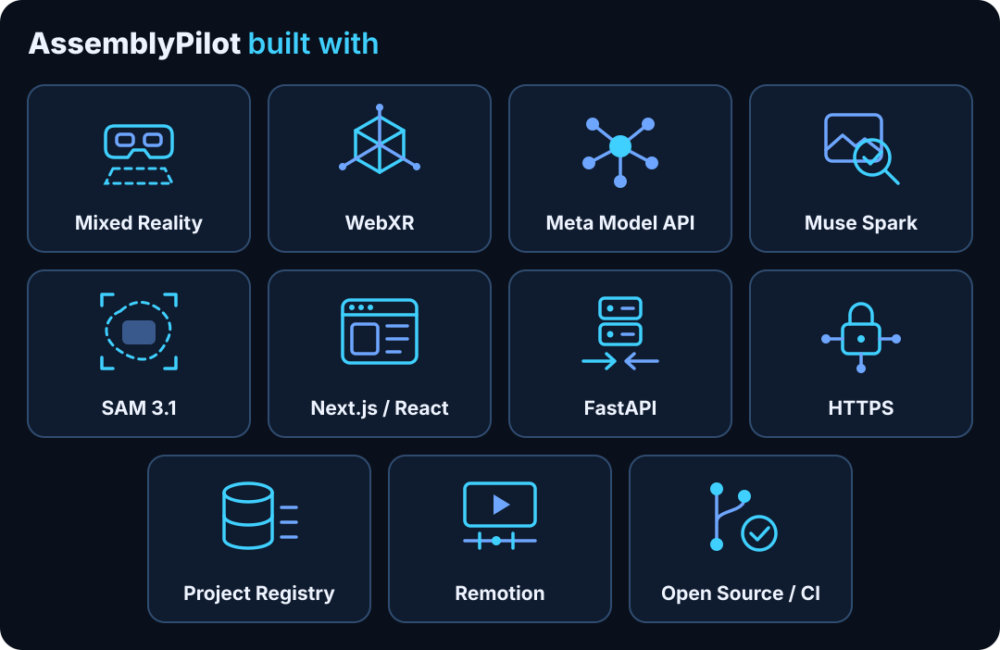

| Tile | Part | Used for |
| --- | --- | --- |
| 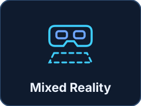 | Mixed Reality | HoloLens 2 headset view through WebXR |
| 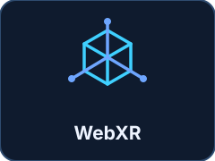 | WebXR | WebXR session and three.js hologram |
| 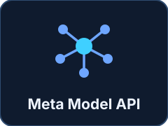 | Meta Model API | Hosted inference, called only by the backend |
| 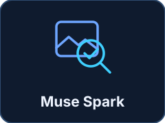 | Muse Spark | Evaluates the assembly state |
| 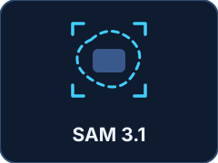 | SAM 3.1 | Optional object localization and segmentation |
| 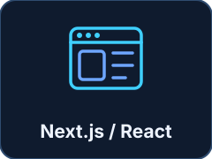 | Next.js / React | Web workspace, setup wizard and AR page |
| 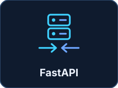 | FastAPI | Python API and Assembly Orchestrator |
|  | HTTPS | Caddy with an internal CA on the private network |
| 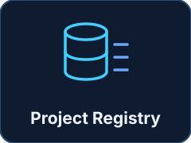 | Project Registry | SQLite and local reference photos |
| 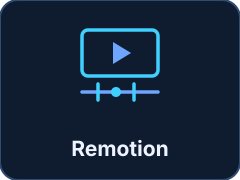 | Remotion | Separate demo video project |
| 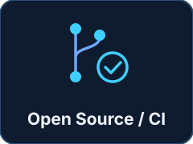 | Open Source / CI | Apache-2.0 source and GitHub Actions checks |

The pictograms are generic drawings made for this repository, not product logos.

## 🎯 Problem

Following a printed manual leaves the checking to the person building. Mistakes such as a
wrong colour, a misplaced part or a printed face turned the wrong way are easy to miss
and expensive to find later. A plain vision model alone is not enough for a physical
workflow, for three reasons:

- A single image can be ambiguous, and a confident guess is worse than an honest "I
  cannot tell".
- A correction must be confirmed by new evidence, not by a click or an old photo.
- In a headset, a wrong or stale status is shown as if it were fact, so results must be
  bound to the exact step and image they came from.

## ✨ Solution and user flow

The system is an **orchestrated AI workflow** with specialized workflow roles, not a set of
autonomous agents. The modules in `backend/app/agents/` are early, context-free helpers that
the active routes do not use.

AssemblyPilot registers what should be built (blocks, ordered steps, reference photos) and
then runs a closed loop for each step: show the target, capture a real image, judge it,
guide the correction, and accept the step only after a separate fresh image is confirmed
by the backend.

There are two front ends over one backend workflow:

- **Web workspace** (`/`): capture, inspect, correct and verify in a browser.
- **Spatial AR** (`/ar?project=<id>`): a WebXR hologram and a floating panel on HoloLens 2.
  Without an XR session the same page offers a guided 2D card.

The guided flow is:

1. Confirm the assembly field on the table (AR only).
2. Place the brick and select **Check Step**.
3. Follow the result: **Next Step**, adjust and **Check Again**, or change the view.
4. On the last verified step select **Finish**, then optionally **Restart Assembly**.

## 🏗️ System architecture

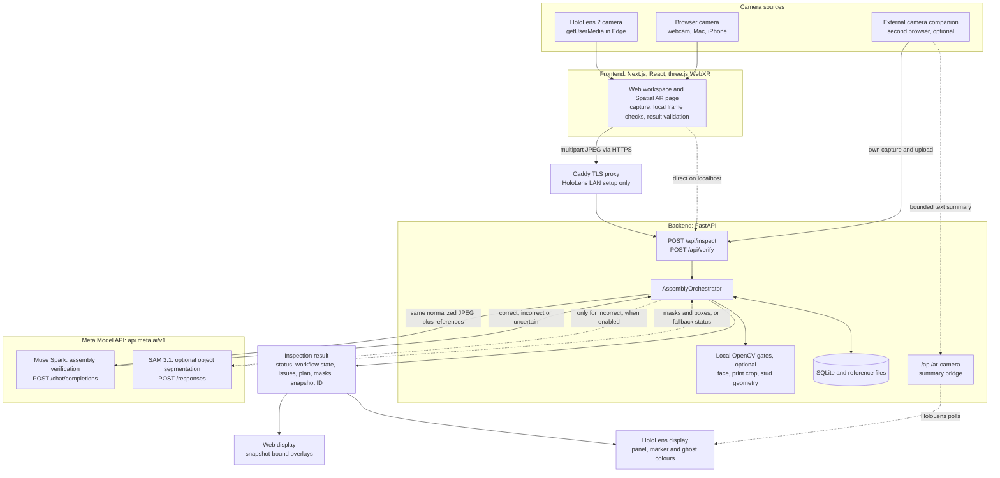

Solid lines are the normal path; dashed lines are conditional. Four details matter:

- Muse Spark and SAM 3.1 are separate calls to separate endpoints, not one model call.
- SAM runs **after** Muse and only for `incorrect`, so it cannot influence Muse's decision.
- Local OpenCV gates sit beside Muse in the backend and do not use the Meta API.
- The browser never talks to Meta. Only the backend holds the key.

## Data flow: from HoloLens camera image to display

1. **Capture.** The browser opens the camera with `getUserMedia` and draws a live frame to
   a canvas. The result is a JPEG in memory, not the WebXR canvas and not a stored image.
2. **Freshness.** On the guided path two samples must show an advancing frame clock. If
   not, or if the camera is unavailable in XR, an external capture request is filed
   instead (see [HoloLens 2 deployment](#hololens-2-deployment)).
3. **Local rejection.** Black, blank or content-free frames are rejected before upload
   and reported as camera failures. Nothing goes to Meta.
4. **Upload.** The JPEG goes as multipart form data with `project_id` and `step_id` to
   `POST /api/inspect`, through Caddy on HoloLens. A verification goes to `POST /api/verify`
   and also carries `previous_inspection_id`.
5. **Normalization.** Pillow validates the real format, applies EXIF orientation and emits
   a metadata-free JPEG with a longest edge of `INSPECTION_MAX_DIMENSION` (1280). A second
   native-resolution copy is kept in memory for OpenCV.
6. **Identity and guard.** The backend hashes the JPEG (`snapshot_id`, SHA-256) and fixes a
   specification fingerprint. For verification it rejects a repeated snapshot.
7. **Context.** The selected step photo comes first, followed by face and block references
   up to `META_MAX_REFERENCE_IMAGES` (8).
8. **Local checks.** Printed-face matching runs first and may add one print crop. Geometry
   then runs in parallel with the Muse call. Steps without a configured rule skip them.
9. **Muse Spark.** The backend sends a strict JSON-schema request. The response must pass
   strict Pydantic validation, must name the requested step and may use only registered
   block IDs.
10. **Fusion.** The workflow `state` is computed from Muse, geometry and face results.
11. **SAM 3.1, optional.** For `incorrect` diagnoses the same normalized JPEG may be
    segmented.
12. **Print gate.** Print evidence from Muse is evaluated against the configured rule.
13. **Commit.** Progress is written only if the specification is unchanged. A step becomes
    `verified` only when the fused state is `verified`.
14. **Response.** The browser receives the validated result with the exact analyzed JPEG,
    so overlays can never attach to a different image. The frontend validates the workflow
    state and the JPEG hash.
15. **Display.** The web view shows details and overlays on that exact snapshot. The AR page
    derives its panel state from the result plus server progress and stores only a bounded
    text summary in `sessionStorage` (30-minute limit), never frames or masks.

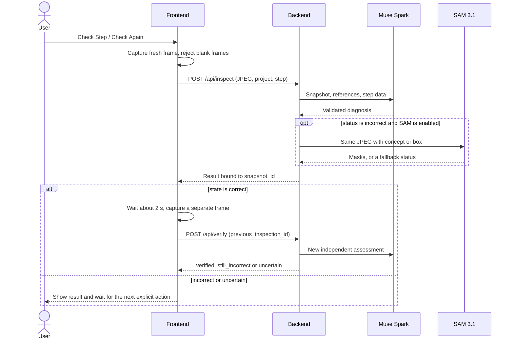

## API endpoints

Everything is served by `backend/app/main.py`. Paths below are the routes of the running
application. `http://localhost:8000/docs` shows the full schema.

| Area | Endpoints | Source |
| --- | --- | --- |
| Health | `GET /health` | `api/health.py` |
| Inspection | `POST /api/inspect`, `POST /api/verify` | `api/inspection.py` |
| Progress and runs | `GET /api/projects/{id}/progress`, `POST /api/projects/{id}/assembly-runs` | `api/projects.py`, `api/ar.py` |
| SAM object search | `POST /api/vision/objects` | `api/object_localization.py` |
| Setup wizard | `POST /api/setup/draft`, `POST /api/setup/projects` | `api/setup.py` |
| Registry | `/api/blocks`, `/api/projects`, step and reference routes, `/api/media/{id}` | `api/blocks.py`, `api/projects.py`, `api/steps.py`, `api/media.py` |
| AR state | `/api/projects/{project}/ar-view`, `/api/projects/{project}/steps/{step}/ar-placement` | `api/ar.py` |
| External camera | `/api/ar-camera` | `api/ar_camera.py` |
| Precision and debug | calibration, geometry, faces, edge debug | `api/calibration.py`, `api/geometry.py`, `api/faces.py`, `api/edge_debug.py` |
| Voice | `/api/voice` | `api/voice.py` |

## Where data is stored

| Data | Location | Lifetime |
| --- | --- | --- |
| Blocks, projects, steps, progress, runs, AR placements, setup receipts | SQLite, `backend/data/assemblypilot.db` | Until deleted |
| Reference photos | `backend/data/uploads` | Until deleted |
| Calibration JSON | `backend/data/calibrations` | Until deleted |
| Inspection sessions, voice sessions, camera bridge | Backend process memory | TTL or backend restart |
| Captured snapshots | Browser memory, and backend memory during a request | Not written to disk unless saved as a reference |
| Setup drafts | Browser memory | Lost on reload |
| XR anchors | Browser session | Lost on exit |
| Local Caddy keys | Caddy data directory, never the repository | Until deleted |

Paths are the defaults; `DATABASE_URL`, `UPLOAD_DIR` and `CALIBRATION_DIR` change them.

## Workflow state transitions

`backend/app/models/workflow.py` defines the states, and `transition()` raises on any other
move. `assembly_orchestrator.py` applies it.

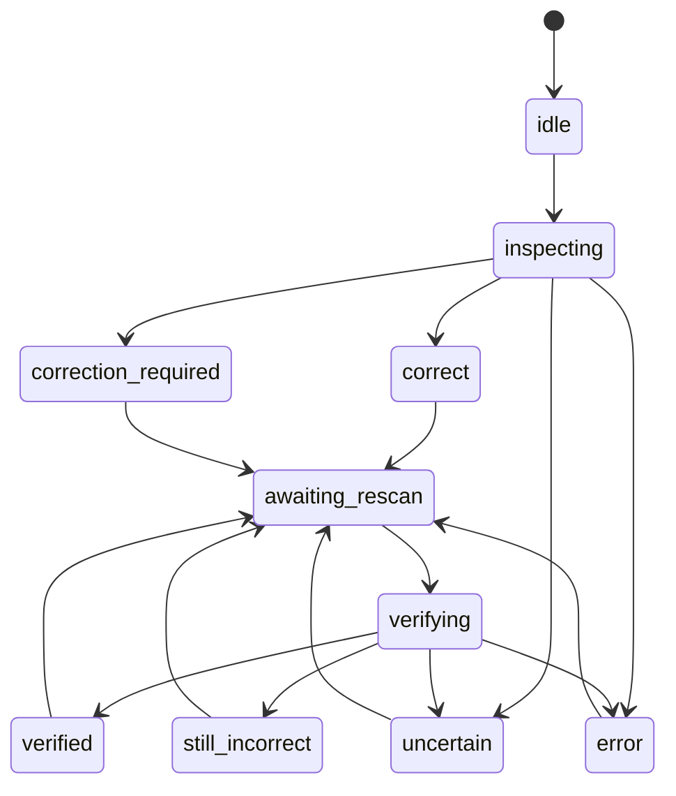

For readability the diagram omits one rule: every state except `idle`, `inspecting` and
`verifying` can also return to `inspecting`.

Persistent progress in `StepProgress` is simpler: `not_started`, `in_progress` or
`verified`. It counts only when it still matches the step's revision and specification
fingerprint, and the run ID is part of that fingerprint. `verified` comes only from the
fused state on a fresh image (`services/progress_service.py`).

## Frontend and backend responsibilities

| Concern | Frontend | Backend |
| --- | --- | --- |
| Camera | Opens it, captures, checks freshness and blank frames | Never accesses a camera |
| Meta access | None; holds no key | Only caller of Meta; owns retries and timeouts |
| Decision | Displays only; validates the response before use | Fuses evidence, owns workflow state |
| Progress | Reads it; can never write `verified` | `step_progress` in SQLite, bound to a specification fingerprint |
| Step cursor | Moves it; handles revision conflicts | Stores the shared `ar_views` cursor |
| Spatial | WebXR session, anchors, hologram, panel, hand ray | Stores placements (`ar_placements`) only |
| Autonomy | Local change detection, budgets, frame selection | No autonomous loop of its own |
| Voice | Records bounded clips | Local Whisper and an allowlist matcher; no LLM |

The backend entry point is `backend/app/main.py`; the workflow is in
`backend/app/services/assembly_orchestrator.py`. The AR page lives in
`frontend/src/components/ar/ARWorkspace.tsx` and `frontend/src/lib/ar/`, where
`guidedFlow.ts` derives the visible state.

## 🧠 Role of Muse Spark

Muse Spark (`META_VISION_MODEL`, default `muse-spark-1.3`) is the semantic judge. Through
`POST https://api.meta.ai/v1/chat/completions` it receives the snapshot, reference photos
and the registered step data, and returns strict JSON containing:

- `status`: `correct`, `incorrect` or `uncertain`
- `issues`, each with expected, observed and a suggested fix
- `visible_blocks`, `explanation`, `next_action`
- `active_vision`, which is required exactly when the status is `uncertain`

The model schema enforces consistency: `correct` cannot carry issues, `incorrect` must carry
at least one, and missing parts cannot have a box. Verification uses the same transport with
a stricter policy. It must assess the whole new image and give an explicit assessment for
every open finding, and `correct` is only accepted if all of them are resolved.

Muse is also used, on an explicit click only, to draft a plan in the setup wizard
(`POST /api/setup/draft`). That draft requires human review and has no verdict role.

### Why Muse Spark makes the assembly decision

Deciding whether a step is right requires comparing a scene with an intended arrangement:
colours, counts, relative placement, visible text, and a description of what is wrong. That
is semantic reasoning over several images and the step text, which Muse provides. Its
structured output also carries the explanation and the fix the user needs.

### Muse and the local gates

Muse's `status` is returned unchanged. The separate workflow `state` adds deterministic
evidence when a step configures it:

| Muse status | Local gates | Workflow state |
| --- | --- | --- |
| `uncertain` | any non-failing | `uncertain` |
| `incorrect` | any | `correction_required` (`still_incorrect` during verification) |
| `correct` | none configured, or all passed | `correct` (`verified` during verification) |
| `correct` | gate inconclusive | `uncertain` |
| any | face or print gate failed | `correction_required` (`still_incorrect` during verification) |
| `correct` | configured geometry failed | `correction_required` (`still_incorrect` during verification) |

Gates can only make a result stricter. No gate can turn a Muse `incorrect` or `uncertain`
into a pass.

## 🧠 Role of SAM 3.1

SAM 3.1 is an **optional** add-on. It locates visible objects and returns validated masks,
from which the app derives boxes and outlines. It does not judge the assembly.

| Setting | Value in code |
| --- | --- |
| Enable switch | `SAM_ENABLED`, default `true` |
| Model | `META_SAM_MODEL`, fixed to `sam-3.1` |
| API key | `MODEL_API_KEY`, the same key as Muse; no separate SAM key exists |
| Endpoint | `POST https://api.meta.ai/v1/responses`, streaming |
| Timeout | `SAM_REQUEST_TIMEOUT`, default and maximum 60 seconds |
| Budget | `SAM_MAX_CONCEPTS_PER_INSPECTION`, default 2, range 0–2 |

**When it runs:** `localize_issues` returns immediately unless Muse's status is `incorrect`.
For each issue:

- Missing parts are skipped: they have nothing to segment.
- `unknown` issues are skipped.
- Misplaced or wrongly oriented parts use a colour concept such as `red building block`.
- Without a usable concept, a valid Muse box is used as a spatial prompt.

A selected mask needs a clear association with the Muse hint. Ambiguous matches are reported
as `ambiguous` and nothing is highlighted. A separate user action,
`POST /api/vision/objects`, searches for objects in an already inspected snapshot.

**Automatic and manual use:**

| Trigger | Runs when | Controlled by |
| --- | --- | --- |
| Automatic | During an inspection whose Muse status is `incorrect` | `SAM_ENABLED`, `SAM_MAX_CONCEPTS_PER_INSPECTION`, `SAM_REQUEST_TIMEOUT`, `META_SAM_MODEL` |
| Manual | The user enters an object in the diagnostic overlay on an inspected snapshot (`ObjectLocalizationControls.tsx`, `POST /api/vision/objects`) | `SAM_ENABLED`, `SAM_REQUEST_TIMEOUT`, `META_SAM_MODEL` |

**Parser and inference are different things.** `meta-sam-parser==0.1.0` is a normal runtime
dependency, always installed, and used locally by `sam_client.py` and `sam_decode.py` to
build prompts and decode responses. Installing it sends nothing to Meta and does not enable
inference. Inference happens only when the backend makes the request above.

### Why SAM only adds localization

SAM segments shapes. It has no knowledge of the step or its specification, so it cannot say
whether a build is right. Keeping it separate also means a segmentation problem can never
produce or change an assembly verdict, and the extra latency and cost occur only where a
highlight helps the user fix something.

The code enforces this:

- `diagnosis.status` is set before SAM runs and is returned unchanged.
- `localize_issues` returns per-issue localization entries, stored only in `segmentations`.
- SAM masks have one further use: `sam_consistent` can reject a conflicting printed-face
  association, which can downgrade the `face` or print detail. This is a negative check
  only, and because SAM runs solely for `incorrect`, the overall result is already
  `correction_required` or `still_incorrect` at that point.

### Behaviour when SAM is not available

The Muse workflow continues in every SAM failure mode:

| Situation | Behaviour |
| --- | --- |
| `SAM_ENABLED=false` | Issue status `disabled`; Muse diagnosis and Muse boxes remain |
| `SAM_MAX_CONCEPTS_PER_INSPECTION=0` or budget used | Issue status `skipped`; no call |
| Timeout, HTTP failure, invalid response | Issue status `unavailable`, with "Muse diagnosis is retained" |
| Zero matches | Issue status `no_match` |
| Several candidates | Issue status `ambiguous`; nothing is highlighted |
| `MODEL_API_KEY` missing | See below |

One case needs precision. SAM and Muse share `MODEL_API_KEY`, so a missing key blocks Muse
as well: `/api/inspect` answers 503 `meta_not_configured` before SAM would run. The SAM-only
code `sam_not_configured` is what `POST /api/vision/objects` returns. Camera, registry and
tests all work without a key, but no AI verdict is produced. A key that is valid for Muse
while SAM calls fail is simply the `unavailable` row above.

SAM is not required for the application. With `SAM_ENABLED=false` the complete inspection,
correction, verification, Finish and Restart flow remains available.

## Behaviour by result

The panel state is derived in `frontend/src/lib/ar/guidedFlow.ts`.

| Result | Panel label | Marker | Buttons |
| --- | --- | --- | --- |
| No result yet | Ready | green | Check Step |
| Running | Capturing image… / Inspecting by Meta… | green | none |
| `correct`, not yet verified | Almost correct | green | Check Again |
| Backend verified | Correct | green | Next Step |
| Backend verified, last step | Final step correct | green | Finish |
| `incorrect` | Try again | red | Check Again |
| `uncertain` | Position uncertain | yellow | Check Again, Confirm Position |
| Failure, no result | Check unavailable | yellow | Check Again, Confirm Position |
| User-confirmed | Confirmed | green | Next Step (none on last step) |
| Finished | Assembly complete | green | Restart Assembly |

### `correct`

A first `correct` is not proof, because a single frame can be wrong. Check Step therefore
waits about two seconds, captures a **separate** frame and sends it to `/api/verify`. The
backend rejects a snapshot hash already used in that session and gives Muse a new
independent assessment. Only then does it write `verified`. If that second step does not
complete, the panel stays at "Almost correct".

### `incorrect`

The panel shows the issue and turns the marker and ghost red. On web, the workspace offers
**I've corrected it** followed by **Capture & Verify**, which calls `/api/verify`. In the
guided AR flow **Check Again** starts a new `/api/inspect`, and a `correct` result then
needs its usual separate verification. Clicking a button never proves a repair; only a new
image can.

### `uncertain`

The panel keeps the result, shows the requested view from Active Vision, and waits. A failed
request is **not** treated as `uncertain`: refusals, truncated or invalid output and
transport failures return errors, never a synthetic verdict.

### Why only Check Again takes a new photo after `uncertain`

The code holds at `uncertain` on purpose (`AutonomousMachine.awaitingUserCheck`, see
`frontend/src/lib/ar/autonomous.ts`). An earlier version re-checked automatically on a
5-second timer, according to `docs/hololens.md`, and that produced repeated paid Meta
requests from an unchanged, still ambiguous view. The reasons for the current behaviour are:

- **New evidence is needed.** `uncertain` means this view was not enough. The same view
  usually gives the same answer, so the user has to act first, usually by moving as Muse
  requested.
- **Cost.** Each inspection is a billable request and can involve retries.
- **Control and stability.** A person wearing a headset should not get a changing status
  while still repositioning a brick.

Therefore, after `uncertain` there is no timer, no change trigger and no automatic request,
even in Autonomous Assembly. Check Again captures exactly one new frame and starts exactly
one inspection. If it is `correct`, the normal verification follows. Another `uncertain`
holds again. The hold ends with a non-uncertain verdict, a step change or Stop.
(`incorrect` differs in Autonomous mode: a detected correction or a bounded re-check may
trigger a new inspection, within the budgets below.)

**Confirm Position** is the fallback when the check cannot decide. It is local state,
labelled "not AI verified", and writes nothing to the backend.

### Finish

Finish appears only on the last step and only after the server reports it as `verified`.
When selected, `finishAssembly` does the following:

1. Refuses if the step is not the last one, an inspection is running, or, in XR, the field
   is not confirmed.
2. Re-reads progress with `GET /api/projects/{id}/progress`.
3. Discards the action if the run, session, anchor, specification or step changed meanwhile.
4. Sets the local finished state, shows "Assembly complete" and starts the completion
   hologram, then ends Autonomous mode if it is active.

Finish writes nothing to the backend and starts no camera or Meta request. The mascot asset
is loaded only now, as a child of the confirmed field origin. If loading fails, the
completion state and XR session remain. The status line reports how many steps the backend
verified; only the last step is required to be verified.

### Restart Assembly

Restart appears after Finish. `restartAssembly` does the following:

1. Ends the local run: Autonomous mode, voice, pending external capture, in-flight results,
   stored summaries and the completion state. A run epoch makes late answers stale.
2. Calls `POST /api/projects/{id}/assembly-runs` with `expected_run_id`.
3. The backend atomically creates a new run and puts the shared cursor on Step 1. The run ID
   is part of each step's specification fingerprint, so all steps read as unverified and a
   request begun in the old run fails its final identity check with 409.
4. If another device restarted first, the 409 makes this device join that run.

Nothing is deleted: project, blocks, references, placements and calibration remain, and the
AR field stays confirmed. No camera, Meta, voice or verification action starts. Offline, the
action is refused, and no server state changes.

## Failure and fallback behaviour

| Failure | Result |
| --- | --- |
| `MODEL_API_KEY` missing | 503 `meta_not_configured`; non-AI features remain usable |
| Base URL other than `https://api.meta.ai/v1` | 503 `meta_configuration`; redirects are never followed |
| 401 or 403 from Meta | 502 `meta_authentication` |
| 402 from Meta | 502 `meta_billing` |
| 429 from Meta | Bounded retry, then 429 with `Retry-After` |
| Meta timeout | 504 `meta_timeout`; one deadline covers all attempts |
| Invalid or incomplete answer | 502 `meta_invalid_response`; never a guessed verdict |
| Corrupt, oversized or unsupported image | 422, 413 or 415 before any Meta call |
| Specification changed during inference | 409; the result is not committed |
| Backend restart | Sessions are lost; verification needs a new inspection; progress remains |
| HoloLens camera unavailable in XR | External capture request with pairing code; XR stays active |
| Two failed AR state polls | The step hologram and verified status are hidden; the field stays |
| Tracking loss | The field stays and is marked degraded or lost; only Re-anchor discards it |

Muse and SAM each make at most three attempts, for transient 429, 500, 502, 503 and transport
failures only. In the guided UI all such failures appear as "Check unavailable".

## 🥽 HoloLens 2 deployment

**Delivery.** This is a web application, not an installed HoloLens app. HoloLens Edge opens
the Next.js page over HTTPS. `deploy/Caddyfile.hololens` terminates TLS on a private LAN
address with Caddy's internal CA, and forwards `/api/*` and `/health` to the backend and all
else to the frontend, both on loopback. The frontend is built with
`NEXT_PUBLIC_API_URL=''` so the API uses the same origin. Commands are in
[Local deployment](local-deployment.md#hololens-2-over-https).

**WebXR.** The page checks `navigator.xr` and `isSessionSupported('immersive-ar')`, and only a
user gesture starts a session. Unsupported devices get a labelled 2D preview. The field uses
a WebXR anchor where available; otherwise the panel reports a session-local pose. Anchors
last for one session. The panel is operated with hand ray and Air Tap.

**Camera in XR.** Inside XR the page uses the normal browser camera API, with an explicit
probe: frames must really advance. Otherwise it falls back to an **external camera companion**.
A second browser with the same HTTPS URL and a pairing code takes the frame and runs the
inspection itself. Only a bounded, validated text summary returns through `/api/ar-camera`.
No frames or masks pass through that bridge, and it cannot mark a step verified.

**Autonomous Assembly (optional).** After an explicit Start, a local change detector works on
small luminance frames. A stable, sharp change can trigger one inspection. Limits are a
20-second interval, 4 automatic requests per step and 12 per session, with one request in
flight at a time. Advancing requires server progress. Pause keeps the camera open with no
analysis. Stop releases it.

**Voice (optional).** HoloLens browser speech recognition is reported as unusable, so short
clips go to Whisper on the Mac over the same HTTPS origin. Commands are matched against an
allowlist. Voice can trigger Check Step or Check Again, but never verifies. Confirm Position,
Finish and Restart Assembly have no voice commands.

**Device status.** `docs/hololens.md` records **owner-reported** observations on a real
HoloLens 2: immersive WebXR works and the 2D workspace shows a live camera image. They are
not reproduced by automated tests. Manual acceptance checklists remain open. The app does not
use the Device Portal, a separate management interface that must not be exposed publicly.

## Images sent to the Meta API

| Situation | Images sent | Destination |
| --- | --- | --- |
| Inspection or verification | `current_snapshot`, plus `block_reference` and `assembled_step_reference` photos up to `META_MAX_REFERENCE_IMAGES`; the longest edge is at most `INSPECTION_MAX_DIMENSION` | Muse, `chat/completions` |
| Print rule configured | Additionally `current_print_crop`, a crop of the snapshot | Muse |
| `incorrect` result | The same validated snapshot JPEG | SAM, `responses` |
| Manual object search | The inspected snapshot | SAM |
| Setup plan generation | Uploaded setup photos, and a selected block's default reference | Muse |
| Autonomous Assembly | Frames after the user pressed Start, within its budgets | Muse, and SAM on `incorrect` |
| External camera companion | The companion's frame goes to the backend, then as above | Muse, SAM |

Images are sent as base64 JPEG, only with an explicit user action or after starting
Autonomous Assembly. Voice audio goes to a local Whisper CLI, never to Meta. This repository
cannot state how long Meta keeps request data; that follows the terms of your API account.

## 🔐 Security and network model

AssemblyPilot is a local demonstration system for a trusted machine or private network.

**Trust boundaries**

- The API has **no authentication** and no inspection rate limit. Both servers stay on
  loopback; only Caddy faces the private LAN, restricted by firewall.
- No public tunnels, port forwarding or public DNS. Port 8000 is not exposed.
- `make dev-backend` binds to `127.0.0.1`. `npm run dev` and `npm run start` bind to
  `0.0.0.0`, so the HoloLens setup starts Next.js explicitly on loopback.
- The pairing code scopes camera requests and is not an authentication mechanism.

**Secrets and outbound traffic**

- `MODEL_API_KEY` stays in backend settings. It is never placed in `NEXT_PUBLIC_*`, URLs or
  responses.
- `MetaClient.endpoint()` accepts only `https://api.meta.ai/v1`, and redirects are not
  followed. This prevents the key from reaching another host.
- The SAM decoder runs in a subprocess that receives no API key, with resource limits.
- Raw provider output is not logged. Errors returned to clients are application-authored.

**Browser and input**

- CORS allows one exact origin; a wildcard is rejected at startup.
- Uploaded bytes are validated independently of file names, with size, pixel and dimension
  limits. Media paths are checked against the upload root.
- Client-visible results are validated again in the frontend, including the JPEG hash.

**Data handling**

- Camera frames are not stored by the app. Only explicit reference photos are saved locally.
- On inspection the current image, selected references and step data go to Meta.
- Voice clips go only to the local backend, are not sent to Meta and are deleted immediately.
- The setup planner treats user text and images as untrusted data.

## 🧪 Test strategy

The CI workflow (`.github/workflows/ci.yml`) runs on each push and pull request without Meta
credentials:

| Job | Steps |
| --- | --- |
| `backend` | `make check-requirements`, `uv sync --frozen`, `ruff check .`, `pytest` |
| `frontend` | `npm ci`, ESLint, type check, unit tests, build, Playwright with Chromium |

Test layers:

| Layer | Location | What it covers |
| --- | --- | --- |
| Backend | `backend/tests/` | API, database rules, Meta and SAM transport with injected HTTP, verification, geometry, voice |
| Frontend unit | `frontend/unit/` | Guided flow, inspection results, autonomy, change detection, bridge, hologram, mascot, panel |
| Browser | `frontend/tests/` | UI flows against a disposable API, with a synthetic camera, and mocked Meta and XR |
| Live, opt-in | `backend/smoke_*.py`, `backend/benchmark_inspection.py` | Real Meta calls with your own photos; never in CI |

**What this proves.** The workflow rules, schemas and failure paths behave as specified. **What
it does not prove.** Model accuracy, physical camera behaviour, HoloLens rendering, frame rate
or alignment.

The latest executed commands and results are in
[submission-readiness.md](submission-readiness.md).

The dated record of earlier checks is [validation.md](validation.md). No Markdown or
documentation check exists in this repository. Results of live smoke tests are not recorded
here, because no such result exists in the repository.

## ⚠️ Known limits and future work

**Current limits**

- Visual judgment from a single view cannot establish hidden connections, exact measurements
  or stability. Confidence is uncalibrated.
- Automatic SAM localization covers only `incorrect` diagnoses and at most two operations.
- Finish verifies only the last step on the server. Earlier steps may be user-confirmed or
  skipped through navigation, which the status count makes visible.
- Confirm Position on the last step cannot complete the assembly.
- Sessions and the camera bridge are in-memory, so use one backend worker.
- `create_all` initializes the schema; there is no migration framework.
- Change detection compensates translation and brightness, and not large perspective changes.
- XR anchors do not persist between sessions.

**Not implemented**

- Authentication, public deployment and inspection rate limits
- Native HoloLens application; a Unity/OpenXR path is only outlined in
  [hololens.md](hololens.md)
- Automatic multi-view fusion, 3D metrology and autonomous physical correction
- Non-Meta inference and local GPU models

**Planned**

- Complete the HoloLens acceptance checklists, including simultaneous camera and WebXR.
- Evaluate real labelled photos with `backend/benchmark_inspection.py`.
- Run the live smoke tests and record the results in `docs/validation.md`.

## Open defects and deviations

Found by reading the implementation. They are documented, not changed here.

| Topic | Behaviour in code | Impact |
| --- | --- | --- |
| Finish scope | Finish checks server progress of the last step only, and reports how many steps were verified | "Assembly complete" does not prove that earlier steps were verified |
| Mascot animation | `meta-mascot-animated.glb` has `Running`, `Walking` and `FunnyDancing_02` only; Wave and Idle phases are skipped | Do not describe a wave |
| Mascot outside XR | Loaded only in an active XR session | The browser demo shows no mascot |
| `allowedDevOrigins` | `frontend/next.config.ts` lists two fixed private IPs | Affects development mode only; use the production build for LAN tests |

## 🎥 Demo video

[Watch the demo video](https://youtu.be/QWZPpFY55rc). It is made separately in `demo/remotion/`.
The final render is 166.9 seconds, as recorded in
[`CLIP_MAPPING.md`](../demo/remotion/CLIP_MAPPING.md). See the [demo plan](demo-plan.md).
