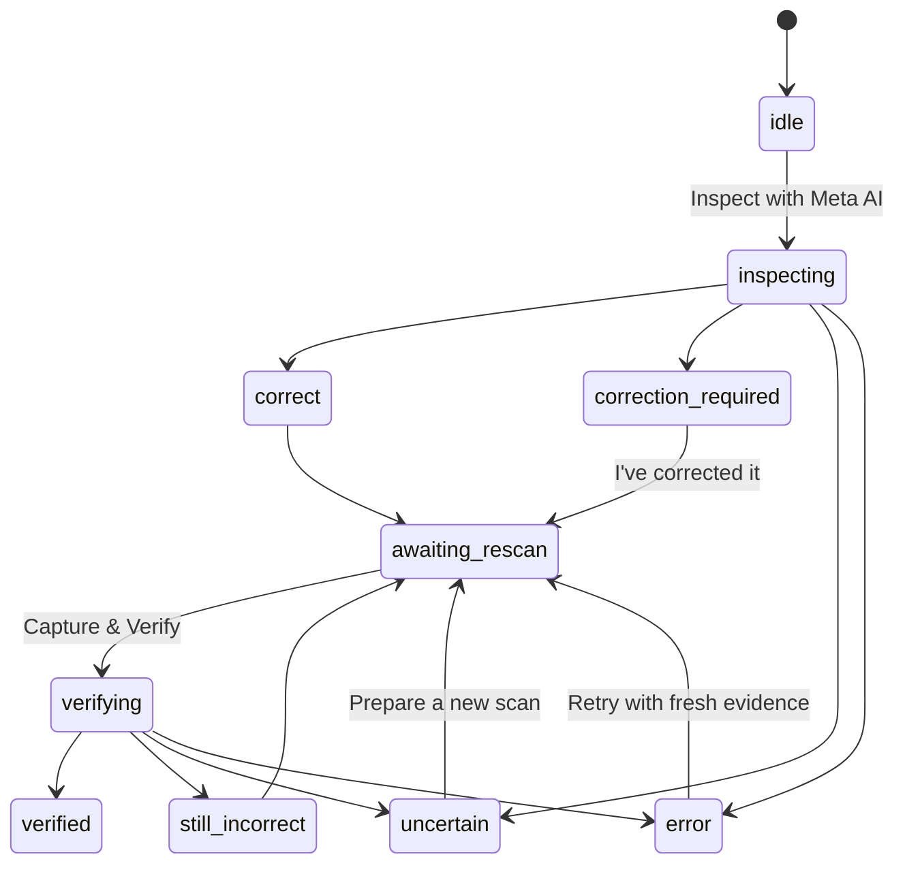

# Closed-loop correction and verification — Phase 4

## Scope and branch basis

Originally implemented from main at `9089e07`. Phase 4 is now merged into main at
`b03d4db`; Phase 4.1A preserves it together with merged SAM PR #5. The active orchestrator runs optional SAM
localization on the exact new image after initial diagnosis or verification. SAM
never changes the semantic diagnosis, resolution assessments or progress decision.
The existing bounded retries, mask validation and Muse-box fallback remain in place.
See [the Phase 4 integration review](pr6-integration-review.md) and
[the calibration architecture](calibration.md) for the combined branch basis.

Next.js, FastAPI, SQLite, registry data, selected step references, camera capture,
Active Vision, diagnostic overlays and temporary image history remain in place.
No authentication, queues, external state service, GPU weights or agent framework
is added. This remains an unauthenticated, trusted-local, single-process MVP.

## Three logical roles

| Role | Implementation | Model operations |
| --- | --- | --- |
| Diagnosis | Existing `MetaClient` + database-backed multimodal request | One Muse operation on the initial frame |
| Correction planning | `correction_planner.plan_corrections` | Zero; reuse validated `suggested_fix`, or the concrete Active Vision instruction |
| Verification | `VerificationClient`, reusing the same transport | One Muse operation on a fresh frame, current specification and previous findings |

The active coordinator is `services/assembly_orchestrator.py`. The older Phase 1
context-free interfaces in `core/orchestrator.py` and `agents/` are still unused;
they are not a second pipeline. The Phase 3B standalone smoke/benchmark tools retain
their existing inspection-only behavior and do not mutate verification progress.

All inference goes to `https://api.meta.ai/v1/chat/completions`, default model
`muse-spark-1.3`, with server-only `MODEL_API_KEY`. The existing destination guard,
strict JSON-schema validation, payload limits and total Meta deadline are reused.
A logical operation can make up to three HTTP attempts for permitted transient
failures. Each successful workflow response reports `muse_call_count: 1`, actual
`meta_attempt_count: 1..3`, and monotonic `model_latency_ms` including retries/parsing.
The initial inspection and verification are separate, user-triggered operations.
No extra planning inference, continuous frame processing or automatic retries of
an entire physical correction cycle occur. Transport retries may incur charges.

Planning does not invent directions, measurements or confidence. It copies supported
diagnosis fields and retains the existing prompt policy against unsupported exact
measurements. Model text remains fallible; validation cannot certify that a suggested
physical adjustment is correct. Uncertain evidence produces camera guidance instead
of a repair plan. No physical action is automated.

## State machine and evidence



The Python and TypeScript transition maps also allow a new initial inspection from
completed/retryable states. A user acknowledgement only enters `awaiting_rescan`.
It cannot enter `verified`. An initially `correct` diagnosis likewise does not mark
progress verified; an explicit new observation is required.

Verification assesses the entire NEW image against the current database specification
and references, not just the reported old error. Every outstanding previous finding
must receive exactly one model assessment: `resolved`, `unresolved` or `uncertain`,
with an explanation supported by the new image. The normal diagnosis schema remains
intact, including optional boxes, nullable confidence and required Active Vision for
uncertainty. `correct` is accepted for verification only if every outstanding prior
finding is explicitly resolved; it maps to `verified`. `incorrect` maps to
`still_incorrect`. Lack of visibility maps to `uncertain`, never invented success.
Unknown IDs, duplicate/missing assessments, inconsistent states and invalid issue
associations are rejected rather than repaired with fabricated defaults.

Each finding has a session UUID, original inspection/snapshot hash, original diagnosis
issue/fix, current resolution/evidence and optional index into the current issues.
When a model links an unresolved finding to a current issue, its block ID and category
must agree and the current issue cannot be assigned twice. Wording alone is not used
for matching. Resolved findings remain in the session history. A new discrepancy gets
a new ID even if earlier discrepancies are resolved. These are logical finding links,
not claims of physical object tracking between changing camera views. Spatial boxes
always belong to their own image; none are copied from the previous response.

## Fresh images and bounded sessions

The browser's **Capture & Verify** action draws the current live video frame directly.
It does not read the old captured image or analyzed snapshot. This capture has a separate
preview inside the verification panel; it does not replace the dashboard's manual
capture and accidentally reset the ongoing correction workflow. Manual capture,
project/step changes and detected specification changes remount/abort the active panel.
Late answers cannot enter the current display or history after that abort.

The backend canonicalizes the JPEG with the existing image processor and computes
SHA-256. Verification rejects a hash already observed in the current chain, including
the initial frame. A byte-identical new camera capture is also rejected: change the
view slightly and capture again. Hashes prevent accidental exact reuse; they cannot
prove camera freshness or detect every re-encoded old photograph. The backend cannot
attest that a physical repair happened, and the UI never treats a click as that proof.

`InspectionSessions` holds at most 64 completed records by default, expiring after
30 minutes from the initial inspection. Expiration is checked on access and lazily
pruned; oldest records are evicted at capacity. A chain is limited to 32 observations
and 200 tracked findings. There are **no camera bytes**, API keys or filesystem paths
in this cache—only identifiers, hashes, bounded diagnostic text and state. The browser
still retains at most ten completed images in tab memory, cleared on refresh/close.

Only one verification may claim a previous inspection at a time. After successful
verification its parent reference is consumed. A new initial inspection supersedes
older references for that step. Provider/validation errors release a claim so it can
be retried, with progress remaining unverified. A process restart or eviction loses
session references; the user starts a new inspection. Use one backend worker; multiple
workers would require shared session coordination and are outside this MVP.

## SQLite progress and invalidation

An additive `step_progress` table is registered by the existing `create_all` startup.
No existing columns/tables/rows are replaced. Existing project/block/reference tables
and images survive. Back up the database and upload directory before changing versions,
as already described in README.

Each row stores only step ID, specification hash, status, request revision, most recent
completed inspection ID and optional UTC verification time. It contains no diagnostic
text or images. No row means `not_started`; a started operation means `in_progress`;
only an accepted verification with sufficient evidence can write `verified`.

The specification hash covers project/step revision metadata, instructions/order,
assigned quantities, registered block specifications and ordered reference metadata
(including selected photo). Progress reads compare the saved version to current data.
A mismatch returns `not_started` and hides the old verification time. The stored old
version is historical metadata, never valid progress on its own. Reverting an edit does
not revive verification because revision timestamps change. The policy is conservative:
project edits can invalidate every step; even unused photo-list changes invalidate a
step. Already issued session references are rejected after any such version change.

Short `BEGIN IMMEDIATE` transactions serialize starting and completing operations.
No database transaction is held during Meta inference. Immediately before committing
a result, the coordinator checks both the current specification and request revision.
Editing, deleting or starting another inspection while inference runs prevents the
stale result from recording verified progress. Concurrent duplicate verification is
rejected before another Meta operation. Progress survives restart; sessions do not.
The UI refreshes progress on completion, focus and every ten seconds (metadata only,
not inference); a changed specification hash clears the active correction state.

## HTTP contracts and failures

`POST /api/inspect` preserves its multipart `image`, `project_id`, `step_id` inputs
and existing diagnosis fields. Successful context-aware responses add:

- `inspection_id`, `snapshot_id`, `specification_id`
- `state`, `tracked_issues`, `correction_plan`
- logical `muse_call_count` and actual `meta_attempt_count`

The legacy image-only 501 response is unchanged. Old Phase 3B response fixtures remain
readable in the frontend, but cannot enable verification without validated session metadata.

`POST /api/verify` requires multipart `image`, `project_id`, `step_id` and
`previous_inspection_id`. It obtains expected parts and reference bytes from SQLite;
client-supplied expected parts, prior findings or paths are not inputs to reasoning.
The response contains `verification_id`, `previous_inspection_id`, status
(`verified | still_incorrect | uncertain`), `issue_assessments`, and a full new
`inspection` including its own analyzed JPEG, timing, corrections and finding history.
Current non-resolved linked findings are remaining issues; newly assigned finding IDs
identify new issues. The response does not duplicate those lists under separate names.

`GET /api/projects/{project_id}/progress` returns each step's ID, current specification
hash, effective `not_started | in_progress | verified` status and optional verification
UTC time. There is no client endpoint that sets a step verified by assertion.

| Failure | Behavior |
| --- | --- |
| Missing required input / corrupt image | 422; no inference |
| Unsupported image / oversized image | 415 / 413; no inference |
| Missing project/step or unavailable previous inspection | 404 |
| Cross-context, duplicate image, busy/consumed/superseded parent, changed specification | 409; no fabricated result |
| Expired session | 410; start a new inspection |
| Missing key | 503; registry/camera remain usable |
| Authentication/access or malformed model evidence | 502 |
| Rate limit | 429 with Retry-After |
| Model deadline | 504 |

Provider failures use “AI verification is temporarily unavailable. Please retry.” with
safe configuration/retry guidance. Client validation/session problems retain their
specific messages. A failed operation does not classify the physical assembly.
Browser cancellation stops local display; it cannot guarantee Meta stops work or billing
already in progress. No provider body, credential or image bytes are logged as errors.

## Four-Block Color Tower — real manual acceptance test

Use your existing registered **Four-Block Color Tower**, real individual block photos
and correctly assembled step photos. Do not substitute synthetic test fixtures. This
procedure sends potentially billable Meta requests and writes progress metadata.

1. Start both services with `make dev-backend` and `make dev-frontend`. Configure the
   backend key in `backend/.env` or its process environment. For a local file named
   `.env.backend`, explicitly load it with `uv run --env-file .env.backend --frozen
   uvicorn app.main:app --host 127.0.0.1 --port 8000` from `backend/`.
2. Select the four-block project and Step 4, **Attach the Green Top Block**. Confirm
   the chosen reference photograph shows the intended construction.
3. Intentionally offset the green top block, keeping the difference visible. Start
   the camera, capture a frame, then click **Inspect with Meta AI**.
4. Confirm an actual incorrect diagnosis and **Correction Required**. If the answer
   is uncertain, follow Active Vision and inspect a clearer frame; do not treat that
   attempt as successful detection. Record the original image, finding and latency locally.
5. Read the correction, physically adjust the block, then click **I've corrected it**.
   Confirm this alone changes neither progress to verified nor the current step.
6. Choose **Capture & Verify**. Confirm the fresh capture preview and **Verifying
   Assembly…**, with the live camera still running.
7. Accept **Step Verified** only if the real new evidence supports the expected state.
   Inspect finding resolutions, new-image overlay and latency. Otherwise follow
   **Correction Still Required** or **Another View Needed**, then explicitly rescan.
8. Verify progress survives page reload/backend restart without persisting camera images.
   Choose **Continue to Next Step** only explicitly when a next step exists. At the final
   step there is no invented next step; it remains marked verified.
9. Edit the step instruction, required quantity or selected reference, and confirm
   progress becomes `not_started` and old session references cannot verify it.

For reproducible API replay using two distinct, actual developer photographs and the
same running local backend:

```sh
cd backend
uv run --frozen python smoke_verification.py --run-live \
  --project-id YOUR_FOUR_BLOCK_PROJECT_ID --step-id YOUR_STEP_4_ID \
  --before /absolute/path/to/misplaced-green-block.jpg \
  --after /absolute/path/to/corrected-green-block.jpg
```

The runner requires an incorrect before diagnosis before verifying the after photo.
It prints validated statuses, correction actions, IDs and measured latency, never image
bytes or credentials. Exit 0 means a real incorrect→verified response sequence; exit 2
means the scenario was inconclusive/still incorrect/uncertain; exit 1 means failure;
exit 77 means explicit opt-in/inputs were missing and no request was sent. It never
overwrites/commits photos or fabricates success. This is a two-photo replay, not proof
that a human followed the correction after reading it; the interactive UI procedure
above tests that timing and the physical camera.

The user reports that live Muse inference works locally. The new Phase 4 workflow has
not yet been demonstrated with real photos in this cloud instance; see the dated
[validation record](validation.md). Visual verification is probabilistic and does not
certify structural stability, internal connections, exact dimensions or safety.
